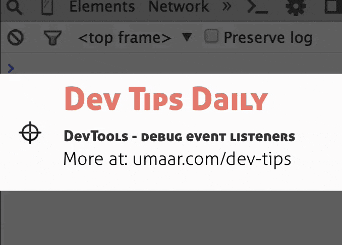
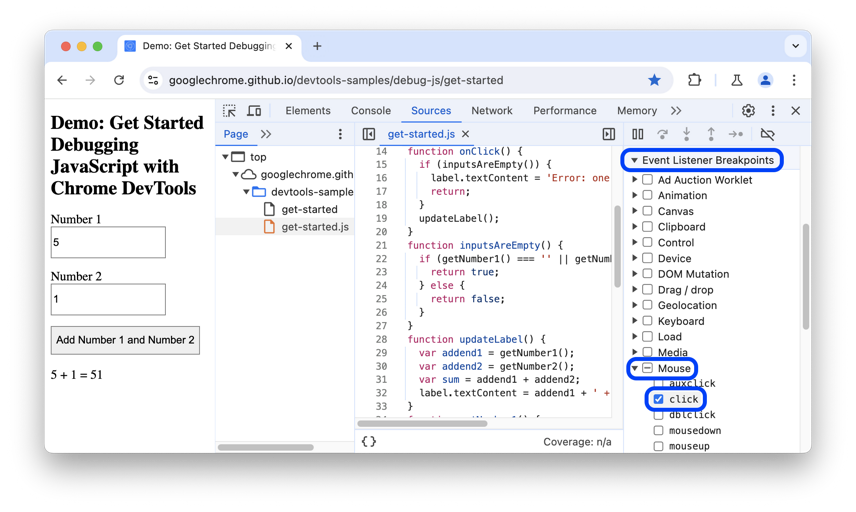

Modern web applications are interactive and dynamic largely thanks to event handling in JavaScript. Through events, your code can react to user interactions (like clicks, keystrokes, and mouse movements) as well as browser-generated events (such as page loading and resizing). Mastering event handling is key to building responsive applications, and understanding how to register, manage, and debug events will help you create cleaner and more efficient code.

---

## 2. Core Concepts

### 2.1 What Are Events and Event Listeners?

- **Events** are signals generated when the user or browser performs an action (e.g., clicking a button or submitting a form).
- **Event Listeners/Handlers** are functions that “listen” for these events on DOM elements. When the event occurs, the attached function (the handler) is executed.


https://developer.mozilla.org/en-US/docs/Web/Events

https://www.w3schools.com/jsref/dom_obj_event.asp


Types of JavaScript Events

Some common event types include:

    Mouse Events: click, dblclick, mouseover, mouseout, mousemove

    Keyboard Events: keydown, keypress, keyup

    Form Events: submit, change, focus, blur

    Window Events: load, resize, scroll


For example, consider a button click event:

```html
<!-- HTML -->
<button id="myButton">Click me!</button>
```

```javascript
// JavaScript
document.getElementById("myButton").addEventListener("click", function() {
  alert("Button clicked!");
});
```

### 2.2 Methods of Registering Event Listeners

There are several ways to register events in JavaScript:

1. **Inline Event Handlers (Not Recommended):**
   ```html
   <button onclick="alert('Clicked!')">Click me!</button>
   ```
   *Mixes behavior (JavaScript) with structure (HTML) and limits flexibility.*

2. **Assigning to DOM Event Properties:**
   ```javascript
   const button = document.getElementById("myButton");
   button.onclick = function() {
     alert("Button clicked via DOM property!");
   };
   ```
   *Better separation than inline methods, but only one function can be assigned per event type.*

3. **Using `addEventListener`:**  
   This is the most flexible, allowing multiple listeners and fine control over event flow.
   ```javascript
   const button = document.getElementById("myButton");
   button.addEventListener("click", function(event) {
     alert("Clicked using addEventListener!");
   });
   ```
   
   the string "click", to indicate that we want to listen to the click event. Buttons can fire lots of other events, such as "mouseover" when the user moves their mouse over the button, or "keydown" when the user presses a key and the button is focused.


4. **Using another function**
It is fine to make the handler function a separate named function, like this:

```js
const btn = document.querySelector("button");

function random(number) {
  return Math.floor(Math.random() * (number + 1));
}

function changeBackground() {
  const rndCol = `rgb(${random(255)} ${random(255)} ${random(255)})`;
  document.body.style.backgroundColor = rndCol;
}

btn.addEventListener("click", changeBackground);
```


### 2.3 The Event Object

When an event fires, the browser passes an **Event object** to the handler, containing useful information:
- **Properties:**
  - `event.type` – The type of event (e.g., "click", "keydown").
  - `event.target` – The element that triggered the event.
  - `event.currentTarget` – The element the event handler is attached to.
  - Mouse-related properties: `event.clientX`, `event.clientY` (coordinates).
  
- **Methods:**
  - `event.preventDefault()` – Prevents the default browser behavior (e.g., following a link).
  - `event.stopPropagation()` – Stops the event from bubbling (or capturing) further.
  - `event.stopImmediatePropagation()` – Prevents any additional handlers on the same element from running.

**Example:**
```javascript
document.getElementById("myButton").addEventListener("click", function(event) {
  console.log("Event type:", event.type);
  console.log("Clicked on:", event.target);
});
```


### event.target vs event.currentTarget
Both event.target and event.currentTarget are properties of the event object in the DOM, but they serve different purposes when dealing with event handling, particularly with event delegation and propagation.

    event.target
    This property returns the element on which the event originally occurred (i.e. the deepest element that was clicked). This is the element that triggered the event.

    event.currentTarget
    This property returns the element to which the event listener is attached. When you add an event listener using methods like addEventListener(), the listener is bound to a particular element—even if the event bubbles up from a child element, event.currentTarget remains the element that holds the listener.

Below is a code example that demonstrates the difference:
Example Code

Consider the following HTML:

<div id="parent" style="padding:20px; border:1px solid #333;">
  Parent Div
  <button id="child" style="margin-top:10px;">Click Me!</button>
</div>

Now, attach an event listener to the parent element:

// Select the parent element
const parentDiv = document.getElementById("parent");

parentDiv.addEventListener("click", function(event) {
  console.log("event.target:", event.target);         // The element that was clicked
  console.log("event.currentTarget:", event.currentTarget); // The element with the listener
});

What Happens When You Click the Button?

    event.target: If you click directly on the button (with id "child"), the event.target will be the button element. This shows the original element where the click event occurred.

    event.currentTarget: Regardless of where you click inside the #parent div, the event.currentTarget will always be the parent element because that’s where the event listener is attached.

Running the Example

    If you click the text within the button:

        event.target logs the button element.

        event.currentTarget logs the <div id="parent"> element.

    If you click somewhere else within the parent div (but not on the button):

        Both event.target and event.currentTarget log the <div id="parent"> element.


---

## 3. Event Propagation: Bubbling vs. Capturing

### 3.1 Event Bubbling
By default, events propagate upward through the DOM hierarchy. When you click on an element, the event is fired on that element (the target) and then "bubbles up" to its parent elements.

**Example:**
```html
<div id="parent">
  <button id="child">Click me!</button>
</div>
```
```javascript
document.getElementById("parent").addEventListener("click", function() {
  console.log("Parent clicked");
});

document.getElementById("child").addEventListener("click", function() {
  console.log("Child clicked");
});
```
*Output when the button is clicked:*
```
Child clicked!
Parent clicked!
```

### 3.2 Event Capturing
The capturing phase works in reverse of bubbling—it starts at the outermost element and moves inward to the target element. To register a listener in the capture phase, pass `true` as the third argument to `addEventListener`.

**Example:**
```javascript
document.getElementById("parent").addEventListener("click", function() {
  console.log("Parent (capturing) clicked");
}, true);
```

### 3.3 Preventing Propagation
To stop an event from propagating further, you can call:
- `event.stopPropagation()`
- `event.stopImmediatePropagation()` (also stops other handlers on the same element).

**Example:**
```javascript
document.getElementById("child").addEventListener("click", function(event) {
  event.stopPropagation();
  console.log("Child clicked (no bubbling to parent)");
});
```

---

## 4. Common Uses with Code Examples

### 4.1 Click Events
```javascript
const button = document.getElementById("myButton");
button.addEventListener("click", function(event) {
  // Optionally prevent default behavior (not needed for buttons)
  console.log("Button was clicked!");
});
```

### 4.2 Form Submission
Prevent default browser behavior (reloading/redirecting) when a form is submitted:
```javascript
const form = document.getElementById("myForm");
form.addEventListener("submit", function(event) {
  event.preventDefault(); // Stop the form from submitting normally
  // Validate input, process data
  console.log("Form data processed.");
});
```

### 4.3 Keyboard Events
Capture key presses to trigger actions:
```javascript
document.addEventListener("keydown", function(event) {
  if (event.key === "Enter") {
    console.log("Enter key pressed!");
  }
});
```

### 4.4 Mouseover/Mouseout Events
```javascript
const element = document.getElementById("hoverArea");
element.addEventListener("mouseover", function() {
  element.style.backgroundColor = "lightblue";
});
element.addEventListener("mouseout", function() {
  element.style.backgroundColor = "";
});
```

### 4.5 Touch Events (for Mobile)
```javascript
element.addEventListener("touchstart", function(event) {
  console.log("Touch started at:", event.touches[0].clientX, event.touches[0].clientY);
});
```


When you open a page, the following events occur in sequence:

    DOMContentLoaded – the browser fully loaded HTML and completed building the DOM tree. However, it hasn’t loaded external resources like stylesheets and images. In this event, you can start selecting DOM nodes or initialize the interface.

    load – the browser fully loaded the HTML and external resources like images and stylesheets.

When you leave the page, the following events fire in sequence:

    beforeunload – fires before the page and resources are unloaded. You can use this event to show a confirmation dialog to confirm if you want to leave the page. By doing this, you can prevent data loss in case the user is filling out a form and accidentally clicks a link that navigates to another page.

    unload – fires when the page has completely unloaded. You can use this event to send the analytic data or to clean up resources.

```js
<!DOCTYPE html>
<html>
<head>
    <title>JS Page Load Events</title>
</head>

<body>
    <script>
        addEventListener('DOMContentLoaded', (event) => {
            console.log('The DOM is fully loaded.');
        });

        addEventListener('load', (event) => {
            console.log('The page is fully loaded.');
        });

        addEventListener('beforeunload', (event) => {
            // show the confirmation dialog
            event.preventDefault();
            // Google Chrome requires returnValue to be set.
            event.returnValue = '';
        });

        addEventListener('unload', (event) => {
            // send analytic data
        });
    </script>
</body>
</html>
```


---

## 5. Common Issues and Pitfalls

### 5.1 Misunderstood Propagation
- **Issue:** Multiple handlers trigger unexpectedly because of event bubbling.
- **Solution:** Use `event.stopPropagation()` or `event.stopImmediatePropagation()` to control the event flow.

### 5.2 Incorrect `this` Binding
- **Issue:** When using arrow functions as event handlers, `this` does not refer to the DOM element.
- **Solution:** Use regular function expressions if you need `this` to refer to the element.
  ```javascript
  // Incorrect: Arrow function will not have its own "this"
  button.addEventListener("click", (event) => {
    console.log(this); // Likely undefined or window in strict mode
  });
  
  // Correct: Use a regular function
  button.addEventListener("click", function(event) {
    console.log(this); // "this" refers to the button element
  });
  ```

### 5.3 Memory Leaks
- **Issue:** Not removing event listeners when elements are removed or no longer needed.
- **Solution:** Remove event listeners using `removeEventListener()` when appropriate.

### 5.4 Performance Challenges
- **Issue:** Attaching separate listeners to many elements can slow down your page.
- **Solution:** Use event delegation—attach a single listener to a common parent and filter events based on `event.target`.
  ```javascript
  document.getElementById("list").addEventListener("click", function(event) {
    if (event.target && event.target.nodeName === "LI") {
      console.log("List item clicked:", event.target.textContent);
    }
  });
  ```

---

## 6. Best Practices

### 6.1 Use `addEventListener`
- **Why:** It supports multiple listeners, provides fine control over propagation, and separates behavior from structure.

### 6.2 Use Named Functions
- **Why:** Named functions facilitate debugging and allow you to remove the listener later if needed.
  ```javascript
  function handleButtonClick(event) {
    alert("Button was clicked!");
  }
  button.addEventListener("click", handleButtonClick);
  // Later, remove it
  button.removeEventListener("click", handleButtonClick);
  ```

### 6.3 Implement Event Delegation
- **Why:** To optimize performance when handling events on many child elements.
- **How:** Attach a listener to the parent element and then inspect `event.target` to act only on specific child elements.

### 6.4 Prevent Default Behavior and Propagation When Necessary
- **Why:** To override browser defaults or limit event handling to only intended elements.
  ```javascript
  link.addEventListener("click", function(event) {
    event.preventDefault();
    // Custom behavior here
  });
  ```

### 6.5 Optimize High-Frequency Events
- **Why:** Events like scroll or resize fire rapidly.
- **How:** Use techniques like debouncing or throttling to control execution frequency.

### 6.6 Remove Unnecessary Listeners
- **Why:** To avoid memory leaks and unnecessary processing.
- **How:** Use `removeEventListener()` when elements are removed or when the handler is no longer needed.

### 6.7 Consider Passive Event Listeners for Touch/Scroll Events
- **Why:** They improve performance by informing the browser that the event handler will not call `preventDefault()`.
  ```javascript
  window.addEventListener("scroll", function(event) {
    // Handle scroll
  }, { passive: true });
  ```

---

## 7. Advanced Topics

### 7.1 Custom Events
Create and dispatch your own events to decouple components of your application.
```javascript
const customEvent = new CustomEvent("myCustomEvent", {
  detail: { message: "Hello from custom event!" }
});
document.dispatchEvent(customEvent);

document.addEventListener("myCustomEvent", function(event) {
  console.log(event.detail.message);
});
```

### 7.2 Debouncing and Throttling
Control how often an event handler runs for events that fire frequently (e.g., resizing or scrolling).
- **Debouncing:** Run a function only after a pause in events.
- **Throttling:** Limit a function to run once per specified time interval.

**Simple debouncing example:**
```javascript
function debounce(func, delay) {
  let debounceTimer;
  return function(...args) {
    clearTimeout(debounceTimer);
    debounceTimer = setTimeout(() => func.apply(this, args), delay);
  };
}

window.addEventListener("resize", debounce(() => {
  console.log("Resize event handler executed after a delay");
}, 250));
```

---

## 8. Debugging Event Handling

### 8.1 Browser Developer Tools
- Use tools like **Chrome DevTools** or **Firefox Developer Tools** to inspect elements, view attached event listeners, and watch for errors or unexpected event firing.
- Set breakpoints within your event handlers to step through code execution.

### 8.2 Logging and Breakpoints
- Utilize `console.log()` to verify if your event handler is triggered.
- Use the `debugger` statement within an event handler for pause-and-inspect.

### 8.3 getEventListeners(node) 
You can use getEventListeners(node) in the Console Panel to retrieve registered event listeners on the passed in DOM node. In addition to that, the video clip shows debug(fn)invoking the debugger when fn is called.




### 8.4 set event breakpoints

To pause the code around the time that the click listener executes. Event Listener Breakpoints let you do exactly that:

In the Debugger section, click Event Listener Breakpoints to expand the section. DevTools reveals a list of expandable event categories, such as Animation and Clipboard.
Next to the Mouse event category, click arrow_right Expand. DevTools reveals a list of mouse events, such as click and mousedown. Each event has a checkbox next to it.

Check the click checkbox. DevTools is now set up to automatically pause when any click event listener executes.

The 'click' checkbox is enabled.




This might seem like a lot of code if you’re attaching lots of similar event listeners to many elements. There are a few ways to go about doing that more efficiently. We learned above that we can get a NodeList of all of the items matching a specific selector with querySelectorAll('selector'). In order to add a listener to each of them, we need to iterate through the whole list, like so:

<div id="container">
  <button id="one">Click Me</button>
  <button id="two">Click Me</button>
  <button id="three">Click Me</button>
</div>

// buttons is a node list. It looks and acts much like an array.
const buttons = document.querySelectorAll("button");

// we use the .forEach method to iterate through each button
buttons.forEach((button) => {
  // and for each one we add a 'click' listener
  button.addEventListener("click", () => {
    alert(button.id);
  });
});


Overview of JavaScript page load events

When you open a page, the following events occur in sequence:

    DOMContentLoaded – the browser fully loaded HTML and completed building the DOM tree. However, it hasn’t loaded external resources like stylesheets and images. In this event, you can start selecting DOM nodes or initialize the interface.
    load – the browser fully loaded the HTML and external resources like images and stylesheets.

When you leave the page, the following events fire in sequence:

    beforeunload – fires before the page and resources are unloaded. You can use this event to show a confirmation dialog to confirm if you want to leave the page. By doing this, you can prevent data loss in case the user is filling out a form and accidentally clicks a link that navigates to another page.
    unload – fires when the page has completely unloaded. You can use this event to send the analytic data or to clean up resources.