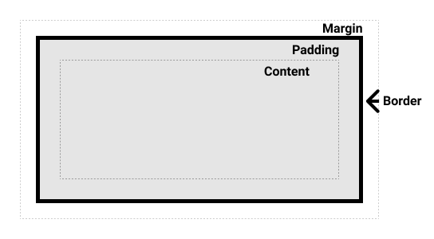
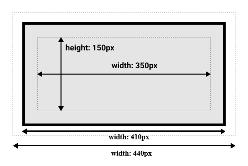
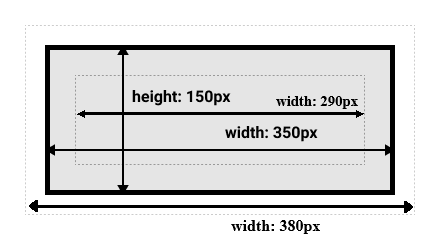
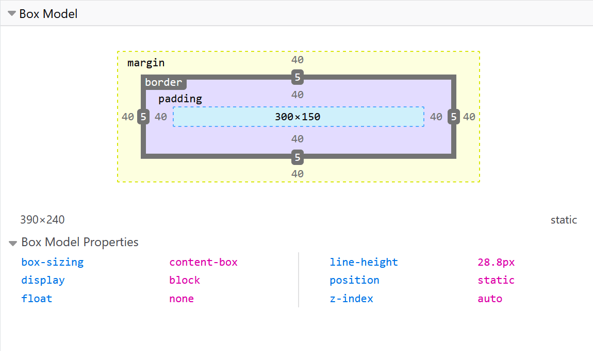

# CSS Box Model

Every HTML element is rendered as a rectangular box.
The CSS box model defines how the size of an element is determined by its content, padding, border, and margin.

Understanding how these boxes are constructed and sized is key to creating well-structured, responsive layouts. 


These boxes can have other boxes in them and can sit alongside one another. 
 
You can get a rough idea of how this works by applying an outline to every element on a page like this:

```css
* {
  outline: 2px solid red;
}
```

---

## Parts of a box

Making up a box in CSS we have four areas; content, padding, boarder, margin.





We will use this html document in the following examples

```html
<!DOCTYPE html>
<html>
  <head>
  </head>
  <body>
      <div class="box"></div>
  </body>
</html>
```

---
###  **Content Box**  
  The innermost area where content (text, images, etc.) is displayed. The `width` and `height` properties by default refer only to this area.  
  Example:  
  ```css
  .box {
    width: 300px;
    height: 150px;
  }
  ```

---
###  **Padding Box**  
  The space between the content and the border. Padding increases the visual space inside the element without affecting the content itself.  
  Example:  
  ```css
  .box {
    padding: 20px;
  }
  ```

---
###  **Border Box**  
  The border wraps the padding and content. Its width, style, and color can be controlled independently.  
  Example:  
  ```css
  .box {
    border: 5px solid #333;
  }
  ```

---
###  **Margin Box**  
  The outermost space that separates the element from its neighbors. Margins are transparent and can even be negative to create overlapping effects.  
  Example:  
  ```css
  .box {
    margin: 10px;
  }
  ```


---
## The Standard Model (content-box)

In the standard box model, also called content-box, when you set `width` or `height` property values on a box, these values define the width or height of the content box. Any padding and borders are then added to those dimensions to get the total size taken up by the box

If we assume that a box has the following CSS:

```css
.box {
  width: 350px;
  height: 150px;
  margin: 15px;
  padding: 25px;
  border: 5px solid black;
}
```



---
### **Formula:**  

**Content width** = width value

**Box width** = left border + left padding + content width + right padding + right border

**Total width** = left margin + box width + right margin

---
### **Calculation:**  

**Content width:** 350px

Total horizontal padding: 25px (left) + 25px (right) = 50px  
Total horizontal border: 5px + 5px = 10px  
**Box width:** 350 + 50 + 10 = 410px  

Note: The margin is not counted towards the actual size of the box — sure, it affects the total space that the box will take up on the page, but only the space outside the box. The box's area stops at the border.

Total horizontal margin: 15px + 15px = 30px  
**Total width:** 350 + 50 + 10 + 30 = 440px


---
## Alternate CSS box model (border-box)

The default box model as seen above, adds padding and borders to the specified width/height. However, you can change this behavior using the `box-sizing` property.

In the alternative box model, any width is the width of the visible box on the page. The content area width is that width minus the width for the padding and border (see image below). No need to add up the border and padding to get the real size of the box.

To turn on the alternative model for an element, set box-sizing: border-box on it:

```css
.box {
  box-sizing: border-box;
  width: 350px;
  height: 150px;
  margin: 10px;
  padding: 25px;
  border: 5px solid black;
}
```

Now, the actual space taken up by the box will be 350px in the inline direction and 150px in the block direction.




---
### **Formula:**  

**Box width** = width value

**Content Width** = box width - left border - left padding - right padding - right border

**Total width** = left margin + box width + right margin


---
### **Calculation:**  

**Box Width:** 350px  

Total horizontal padding: 25px (left) + 25px (right) = 50px  
Total horizontal border: 5px + 5px = 10px  
**Content width:** 350 - 50 - 10 = 290px  

Note: The margin is not counted towards the actual size of the box — sure, it affects the total space that the box will take up on the page, but only the space outside the box. The box's area stops at the border.

Total horizontal margin: 15px + 15px = 30px  
**Total width:** 350 + 30 = 380px

---
### Apply Globally

A common best practice is to apply `border-box` globally to simplify layout work:
```css
*, *::before, *::after {
  box-sizing: border-box;
}
```


---
### Example: Standard Box Model (content-box) vs Border-Box Model
```html
<div class="content-box-example">
  Standard Box Model: content-box
</div>

<div class="border-box-example">
  Border Box Model: border-box
</div>
```
```css
.content-box-example {
  width: 300px;
  padding: 20px;
  border: 5px solid #007acc;
  margin: 15px;
  background-color: #cc7acc;
  box-sizing: content-box; /* Default */
}
/* In this case, the total width = 300 + (20×2) + (5×2) + (15×2) = 300 + 40 + 10 + 30 = 380px. */

.border-box-example {
  width: 300px;
  padding: 20px;
  border: 5px solid #cc7acc;
  margin: 15px;
  background-color: #007acc;
  box-sizing: border-box; /* Padding and border are included */
}

/* Here, the total width remains 300px regardless of padding or border, making layouts more predictable. */
```


---
## Best Practices & Tips

- **Reset and Normalize:**  
  Use a CSS reset or normalize stylesheet to remove inconsistent default padding and margins across browsers.

- **Global Box-Sizing:**  
  Apply `box-sizing: border-box;` globally for easier sizing and layout management.

- **Responsive Layouts:**  
  When working with percentages or fluid layouts, border-box ensures that padding and borders don’t cause unexpected overflows.

- **Use Developer Tools:**  
  Modern browsers’ DevTools visually display the box model for selected elements. Use them to debug layout issues effectively.
  *(For example, inspect elements in Chrome’s DevTools to see the computed box model.)*

- **Margin Collapsing:**  
  Remember that vertical margins between block elements may collapse, affecting spacing. Study margin collapsing rules to avoid surprises.


---
### Use browser DevTools to view the box model

Your browser developer tools can make understanding the box model far easier — they can show you the size of the element plus its margin, padding, and border. Inspecting an element in this way is a great way to find out if your box is really the size you think it is!



---
### Margins, padding, and borders

You've already seen the margin, padding, and border properties at work in the example above. The properties used in that example are shorthands and allow us to set all four sides of the box at once. These shorthands also have equivalent longhand properties, which allow control over the different sides of the box individually.

Let's explore these properties in more detail.

#### Margin

The margin is an invisible space around your box. It pushes other elements away from the box. Margins can have positive or negative values. Setting a negative margin on one side of your box can cause it to overlap other things on the page. Whether you are using the standard or alternative box model, the margin is always added after the size of the visible box has been calculated.

We can control all margins of an element at once using the margin property, or each side individually using the equivalent longhand properties:

    margin-top
    margin-right
    margin-bottom
    margin-left

In the example below, try changing the margin values to see how the box is pushed around due to the margin creating or removing space (if it is a negative margin) between this element and the containing element.

```html
<div class="container">
  <div class="box">Change my borders.</div>
</div>
```

```css
.container {
  border: 5px solid blue;
  margin: 40px;
}

.box {
  border: 5px solid rebeccapurple;
  background-color: lightgray;
  padding: 10px;
  height: 100px;
  /* try changing the margin properties: */
  margin-top: -40px;
  margin-right: 30px;
  margin-bottom: 40px;
  margin-left: 4em;
}
```

#### Margin collapsing

Depending on whether two elements whose margins touch have positive or negative margins, the results will be different:

    Two positive margins will combine to become one margin. Its size will be equal to the largest individual margin.
    Two negative margins will collapse and the smallest (furthest from zero) value will be used.
    If one margin is negative, its value will be subtracted from the total.

In the example below, we have two paragraphs. The top paragraph has a margin-bottom of 50 pixels, the other has a margin-top of 30 pixels. The margins have collapsed together so the actual margin between the boxes is 50 pixels and not the total of the two margins.

You can test this by setting the margin-top of paragraph two to 0. The visible margin between the two paragraphs will not change — it retains the 50 pixels set in the margin-bottom of paragraph one. If you set it to -10px, you'll see that the overall margin becomes 40px — it subtracts from the 50px.
html
```html
<div class="container">
  <p class="one">I am paragraph one.</p>
  <p class="two">I am paragraph two.</p>
</div>
```

```css
.container {
  border: 5px solid blue;
  margin: 40px;
}

p {
  border: 5px solid rebeccapurple;
  background-color: lightgray;
  padding: 10px;
}
.one {
  margin-bottom: 50px;
}

.two {
  margin-top: 30px;
}
```
A number of rules dictate when margins do and do not collapse. For further information see the detailed page on mastering margin collapsing. The main thing to remember is that margin collapsing is a thing that happens if you are creating space with margins and don't get the space you expect.

#### Borders

The border is drawn between the margin and the padding of a box. If you are using the standard box model, the size of the border is added to the width and height of the content box. If you are using the alternative box model, then the bigger the border is, the smaller the content box is, as the border takes up some of that available width and height of the element box.

For styling borders, there are a large number of properties — there are four borders, and each border has a style, width, and color that we might want to manipulate.

You can set the width, style, or color of all four borders at once using the border property.

To set the properties of each side individually, use:

    border-top
    border-right
    border-bottom
    border-left

To set the width, style, or color of all sides, use:

    border-width
    border-style
    border-color

To set the width, style, or color of a single side, use one of the more granular longhand properties:

    border-top-width
    border-top-style
    border-top-color
    border-right-width
    border-right-style
    border-right-color
    border-bottom-width
    border-bottom-style
    border-bottom-color
    border-left-width
    border-left-style
    border-left-color

In the example below, we have used various shorthands and longhands to create borders. Play around with the different properties to check that you understand how they work. The MDN pages for the border properties give you information about the different available border styles.

```html
<div class="container">
  <div class="box">Change my borders.</div>
</div>
```

```css
body {
  font-family: sans-serif;
}
.container {
  margin: 40px;
  padding: 20px;
  border-top: 5px dotted green;
  border-right: 1px solid black;
  border-bottom: 20px double rgb(23 45 145);
}

.box {
  padding: 20px;
  background-color: lightgray;
  border: 1px solid #333333;
  border-top-style: dotted;
  border-right-width: 20px;
  border-bottom-color: hotpink;
}
```

#### Padding

The padding sits between the border and the content area and is used to push the content away from the border. Unlike margins, you cannot have a negative padding. Any background applied to your element will display behind the padding.

The padding property controls the padding on all sides of an element. To control each side individually, use these longhand properties:

    padding-top
    padding-right
    padding-bottom
    padding-left

In the example below, you can change the values for padding on the class .box to see that this changes where the text begins in relation to the box. You can also change the padding on the class .container to create space between the container and the box. You can change the padding on any element to create space between its border and whatever is inside the element.

```html
<div class="container">
  <div class="box">Change my padding.</div>
</div>
```

```css
body {
  font-family: sans-serif;
}
.box {
  border: 5px solid rebeccapurple;
  background-color: lightgray;
  padding-top: 0;
  padding-right: 30px;
  padding-bottom: 40px;
  padding-left: 4em;
}

.container {
  border: 5px solid blue;
  margin: 40px;
  padding: 20px;
}
```

### The box model and inline boxes

All of the above fully applies to block boxes. Some of the properties can apply to inline boxes too, such as those created by a \<span> element.

In the example below, we have a \<span> inside a paragraph. We have applied a width, height, margin, border, and padding to it. You can see that the width and height are ignored. The top and bottom margin, padding, and border are respected but don't change the relationship of other content to our inline box. The padding and border overlap other words in the paragraph. The left and right padding, margins, and borders move other content away from the box.


```html
<p>
  I am a paragraph and this is a <span>span</span> inside that paragraph. A span
  is an inline element and so does not respect width and height.
</p>
```

```css
body {
  font-family: sans-serif;
}
p {
  border: 2px solid rebeccapurple;
  width: 200px;
}
span {
  margin: 20px;
  padding: 20px;
  width: 80px;
  height: 150px;
  background-color: lightblue;
  border: 2px solid blue;
}
```

### Using display: inline-block

display: inline-block is a special value of display, which provides a middle ground between inline and block. Use it if you do not want an item to break onto a new line, but do want it to respect width and height and avoid the overlapping seen above.

An element with display: inline-block does a subset of the block things we already know about:

    The width and height properties are respected.
    padding, margin, and border will cause other elements to be pushed away from the box.

It does not, however, break onto a new line, and will only become larger than its content if you explicitly add width and height properties.

In this next example, we have added display: inline-block to our \<span> element. Try changing this to display: block or removing the line completely to see the difference in display models:

```html
<p>
  I am a paragraph and this is a <span>span</span> inside that paragraph. A span
  is an inline element and so does not respect width and height.
</p>
```

```css
body {
  font-family: sans-serif;
}
p {
  border: 2px solid rebeccapurple;
  width: 300px;
}

span {
  margin: 20px;
  padding: 20px;
  width: 80px;
  height: 50px;
  background-color: lightblue;
  border: 2px solid blue;
  display: inline-block;
}
```

Where this can be useful is when you want to give a link a larger hit area by adding padding. \<a> is an inline element like \<span>; you can use display: inline-block to allow padding to be set on it, making it easier for a user to click the link.

You see this fairly frequently in navigation bars. The navigation below is displayed in a row using flexbox and we have added padding to the \<a> element as we want to be able to change the background-color when the \<a> is hovered. The padding appears to overlap the border on the \<ul> element. This is because the \<a> is an inline element.

Add display: inline-block; to the rule with the .links-list a selector, and you will see how it fixes this issue by causing the padding to be respected by other elements:

```html
<nav>
  <ul class="links-list">
    <li><a href="">Link one</a></li>
    <li><a href="">Link two</a></li>
    <li><a href="">Link three</a></li>
  </ul>
</nav>
```

```css
ul {
  font-family: sans-serif;
  display: flex;
  list-style: none;
  border: 1px solid #000;
}

li {
  margin: 5px;
}

.links-list a {
  background-color: rgb(179 57 81);
  color: #fff;
  text-decoration: none;
  padding: 1em 2em;
}

.links-list a:hover {
  background-color: rgb(66 28 40);
  color: #fff;
}
```