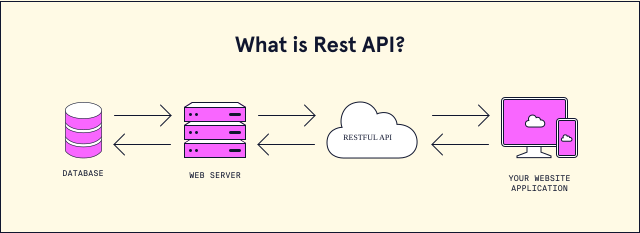

## 1. What Is REST?

REST is an architectural pattern used to design RESTful web APIs. These
APIs are essentially a set of URLs, each of which provides access to a single
resource. They rely on the use of HTTP methods and the standard HTTP
status codes to transmit data and accept URL- encoded or request header
parameters. Typically, they respond with the requested data in JSON or
plaintext.

REST conventions: to access it, we used the HTTP GET method to consume the URL endpoint and
received a JSON response with an HTTP status code of 200: OK. 

Common status code ranges are 
    2XX for successful requests
    3XX for redirects
    4XX for client-related errors
    5XX for server errors

As full-stack developers, we might sometimes create our own APIs; more often, though, we’ll find ourselves consuming third-party APIs.

**REST (Representational State Transfer)** is an architectural style used to design RESTful web APIs. 

REST-compliant systems, often called RESTful systems, or RESTful APIs follow REST principles, meaning that it:
  
- Uses standard HTTP methods (GET, POST, PUT, DELETE) to perform operations.
- Is stateless—each request from the client contains all the information needed.
- Uses resource-based URLs to identify entities.
- Often returns data in a standardized format like JSON.

### Separation of Client and Server

In the REST architectural style, the implementation of the client and the implementation of the server can be done independently without each knowing about the other. This means that the code on the client side can be changed at any time without affecting the operation of the server, and the code on the server side can be changed without affecting the operation of the client.

As long as each side knows what format of messages to send to the other, they can be kept modular and separate. Separating the user interface concerns from the data storage concerns, we improve the flexibility of the interface across platforms and improve scalability by simplifying the server components. Additionally, the separation allows each component the ability to evolve independently.

By using a REST interface, different clients hit the same REST endpoints, perform the same actions, and receive the same responses. 

### Statelessness

Systems that follow the REST paradigm are stateless, meaning that the server does not need to know anything about what state the client is in and vice versa. In this way, both the server and the client can understand any message received, even without seeing previous messages. This constraint of statelessness is enforced through the use of resources, rather than commands. Resources are the nouns of the Web - they describe any object, document, or thing that you may need to store or send to other services.

Because REST systems interact through standard operations on resources, they do not rely on the implementation of interfaces.

These constraints help RESTful applications achieve reliability, quick performance, and scalability, as components that can be managed, updated, and reused without affecting the system as a whole, even during operation of the system.

### Communication between Client and Server

In the REST architecture, clients send requests to retrieve or modify resources, and servers send responses to these requests. Let’s take a look at the standard ways to make requests and send responses.
Making Requests

REST requires that a client make a request to the server in order to retrieve or modify data on the server. A request generally consists of:

    an HTTP verb, which defines what kind of operation to perform
    a header, which allows the client to pass along information about the request
    a path to a resource
    an optional message body containing data

#### HTTP Verbs

There are 4 basic HTTP verbs we use in requests to interact with resources in a REST system:

    GET — retrieve a specific resource (by id) or a collection of resources
    POST — create a new resource
    PUT — update a specific resource (by id)
    DELETE — remove a specific resource by id
