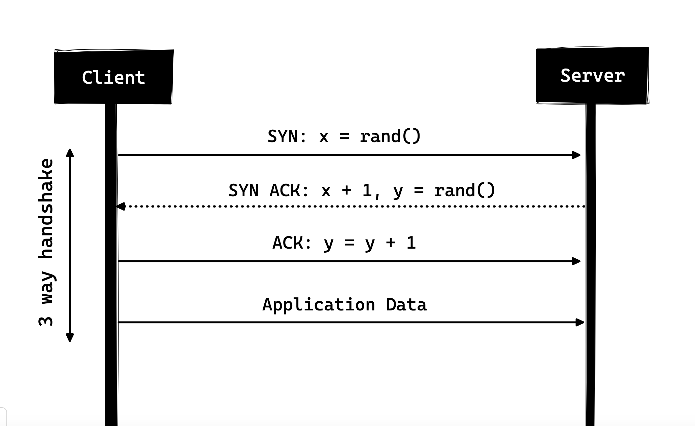

## HTTP/0.9 - The One Liner (1991)

The first documented version of HTTP was HTTP/0.9 which was put forward in 1991. It was the simplest protocol ever; having a single method called GET. If a client had to access some webpage on the server, it would have made the simple request like below

GET /index.html

And the response from server would have looked as follows

(response body)
(connection closed)

That is, the server would get the request, reply with the HTML in response and as soon as the content has been transferred, the connection will be closed. There were

    No headers
    GET was the only allowed method
    Response had to be HTML

As you can see, the protocol really had nothing more than being a stepping stone for what was to come.

## HTTP/1.0 - 1996

In 1996, the next version of HTTP i.e. HTTP/1.0 evolved that vastly improved over the original version.

Unlike HTTP/0.9 which was only designed for HTML response, HTTP/1.0 could now deal with other response formats i.e. images, video files, plain text or any other content type as well. It added more methods (i.e. POST and HEAD), request/response formats got changed, HTTP headers got added to both the request and responses, status codes were added to identify the response, character set support was introduced, multi-part types, authorization, caching, content encoding and more was included.

Here is how a sample HTTP/1.0 request and response might have looked like:

GET / HTTP/1.0
Host: cs.fyi
User-Agent: Mozilla/5.0 (Macintosh; Intel Mac OS X 10_10_5)
Accept: */*

As you can see, alongside the request, client has also sent it’s personal information, required response type etc. While in HTTP/0.9 client could never send such information because there were no headers.

Example response to the request above may have looked like below

HTTP/1.0 200 OK 
Content-Type: text/plain
Content-Length: 137582
Expires: Thu, 05 Dec 1997 16:00:00 GMT
Last-Modified: Wed, 5 August 1996 15:55:28 GMT
Server: Apache 0.84

(response body)
(connection closed)

In the very beginning of the response there is HTTP/1.0 (HTTP followed by the version number), then there is the status code 200 followed by the reason phrase (or description of the status code, if you will).

In this newer version, request and response headers were still kept as ASCII encoded, but the response body could have been of any type i.e. image, video, HTML, plain text or any other content type. So, now that server could send any content type to the client; not so long after the introduction, the term “Hyper Text” in HTTP became misnomer. HMTP or Hypermedia transfer protocol might have made more sense but, I guess, we are stuck with the name for life.

One of the major drawbacks of HTTP/1.0 were you couldn’t have multiple requests per connection. That is, whenever a client will need something from the server, it will have to open a new TCP connection and after that single request has been fulfilled, connection will be closed. And for any next requirement, it will have to be on a new connection. Why is it bad? Well, let’s assume that you visit a webpage having 10 images, 5 stylesheets and 5 javascript files, totalling to 20 items that needs to fetched when request to that webpage is made. Since the server closes the connection as soon as the request has been fulfilled, there will be a series of 20 separate connections where each of the items will be served one by one on their separate connections. This large number of connections results in a serious performance hit as requiring a new TCP connection imposes a significant performance penalty because of three-way handshake followed by slow-start.

## Three-way Handshake

Three-way handshake in it’s simples form is that all the TCP connections begin with a three-way handshake in which the client and the server share a series of packets before starting to share the application data.

    SYN - Client picks up a random number, let’s say x, and sends it to the server.
    SYN ACK - Server acknowledges the request by sending an ACK packet back to the client which is made up of a random number, let’s say y picked up by server and the number x+1 where x is the number that was sent by the client
    ACK - Client increments the number y received from the server and sends an ACK packet back with the number y+1

Once the three-way handshake is completed, the data sharing between the client and server may begin. It should be noted that the client may start sending the application data as soon as it dispatches the last ACK packet but the server will still have to wait for the ACK packet to be recieved in order to fulfill the request.

3 way handshake

However, some implementations of HTTP/1.0 tried to overcome this issue by introducing a new header called Connection: keep-alive which was meant to tell the server “Hey server, do not close this connection, I need it again”. But still, it wasn’t that widely supported and the problem still persisted.

Apart from being connectionless, HTTP also is a stateless protocol i.e. server doesn’t maintain the information about the client and so each of the requests has to have the information necessary for the server to fulfill the request on it’s own without any association with any old requests. And so this adds fuel to the fire i.e. apart from the large number of connections that the client has to open, it also has to send some redundant data on the wire causing increased bandwidth usage.
HTTP/1.1 - 1997

After merely 3 years of HTTP/1.0, the next version i.e. HTTP/1.1 was released in 1999; which made alot of improvements over it’s predecessor. The major improvements over HTTP/1.0 included

    New HTTP methods were added, which introduced PUT, PATCH, OPTIONS, DELETE

    Hostname Identification In HTTP/1.0 Host header wasn’t required but HTTP/1.1 made it required.

    Persistent Connections As discussed above, in HTTP/1.0 there was only one request per connection and the connection was closed as soon as the request was fulfilled which resulted in accute performance hit and latency problems. HTTP/1.1 introduced the persistent connections i.e. connections weren’t closed by default and were kept open which allowed multiple sequential requests. To close the connections, the header Connection: close had to be available on the request. Clients usually send this header in the last request to safely close the connection.

    Pipelining It also introduced the support for pipelining, where the client could send multiple requests to the server without waiting for the response from server on the same connection and server had to send the response in the same sequence in which requests were received. But how does the client know that this is the point where first response download completes and the content for next response starts, you may ask! Well, to solve this, there must be Content-Length header present which clients can use to identify where the response ends and it can start waiting for the next response.

    It should be noted that in order to benefit from persistent connections or pipelining, Content-Length header must be available on the response, because this would let the client know when the transmission completes and it can send the next request (in normal sequential way of sending requests) or start waiting for the the next response (when pipelining is enabled).

    But there was still an issue with this approach. And that is, what if the data is dynamic and server cannot find the content length before hand? Well in that case, you really can’t benefit from persistent connections, could you?! In order to solve this HTTP/1.1 introduced chunked encoding. In such cases server may omit content-Length in favor of chunked encoding (more to it in a moment). However, if none of them are available, then the connection must be closed at the end of request.

    Chunked Transfers In case of dynamic content, when the server cannot really find out the Content-Length when the transmission starts, it may start sending the content in pieces (chunk by chunk) and add the Content-Length for each chunk when it is sent. And when all of the chunks are sent i.e. whole transmission has completed, it sends an empty chunk i.e. the one with Content-Length set to zero in order to identify the client that transmission has completed. In order to notify the client about the chunked transfer, server includes the header Transfer-Encoding: chunked

    Unlike HTTP/1.0 which had Basic authentication only, HTTP/1.1 included digest and proxy authentication

    Caching

    Byte Ranges

    Character sets

    Language negotiation

    Client cookies

    Enhanced compression support

    New status codes

    ..and more

I am not going to dwell about all the HTTP/1.1 features in this post as it is a topic in itself and you can already find a lot about it. The one such document that I would recommend you to read is Key differences between HTTP/1.0 and HTTP/1.1 and here is the link to original RFC for the overachievers.

HTTP/1.1 was introduced in 1999 and it had been a standard for many years. Although, it improved alot over it’s predecessor; with the web changing everyday, it started to show it’s age. Loading a web page these days is more resource-intensive than it ever was. A simple webpage these days has to open more than 30 connections. Well HTTP/1.1 has persistent connections, then why so many connections? you say! The reason is, in HTTP/1.1 it can only have one outstanding connection at any moment of time. HTTP/1.1 tried to fix this by introducing pipelining but it didn’t completely address the issue because of the head-of-line blocking where a slow or heavy request may block the requests behind and once a request gets stuck in a pipeline, it will have to wait for the next requests to be fulfilled. To overcome these shortcomings of HTTP/1.1, the developers started implementing the workarounds, for example use of spritesheets, encoded images in CSS, single humungous CSS/Javascript files, domain sharding etc.
SPDY - 2009

Google went ahead and started experimenting with alternative protocols to make the web faster and improving web security while reducing the latency of web pages. In 2009, they announced SPDY.

    SPDY is a trademark of Google and isn’t an acronym.

It was seen that if we keep increasing the bandwidth, the network performance increases in the beginning but a point comes when there is not much of a performance gain. But if you do the same with latency i.e. if we keep dropping the latency, there is a constant performance gain. This was the core idea for performance gain behind SPDY, decrease the latency to increase the network performance.

    For those who don’t know the difference, latency is the delay i.e. how long it takes for data to travel between the source and destination (measured in milliseconds) and bandwidth is the amount of data transfered per second (bits per second).

The features of SPDY included, multiplexing, compression, prioritization, security etc. I am not going to get into the details of SPDY, as you will get the idea when we get into the nitty gritty of HTTP/2 in the next section as I said HTTP/2 is mostly inspired from SPDY.

SPDY didn’t really try to replace HTTP; it was a translation layer over HTTP which existed at the application layer and modified the request before sending it over to the wire. It started to become a defacto standards and majority of browsers started implementing it.

In 2015, at Google, they didn’t want to have two competing standards and so they decided to merge it into HTTP while giving birth to HTTP/2 and deprecating SPDY.

HTTP/2 - 2015

HTTP/2 is the second major version of the Hypertext Transfer Protocol, designed to overcome many limitations of HTTP/1.1. The protocol was standardized in 2015 and aimed to improve performance, resource utilization, and overall user experience on the web. Its main objectives include reducing latency, supporting multiplexed streams over a single TCP connection, efficient header compression, and improved security when used with TLS.

