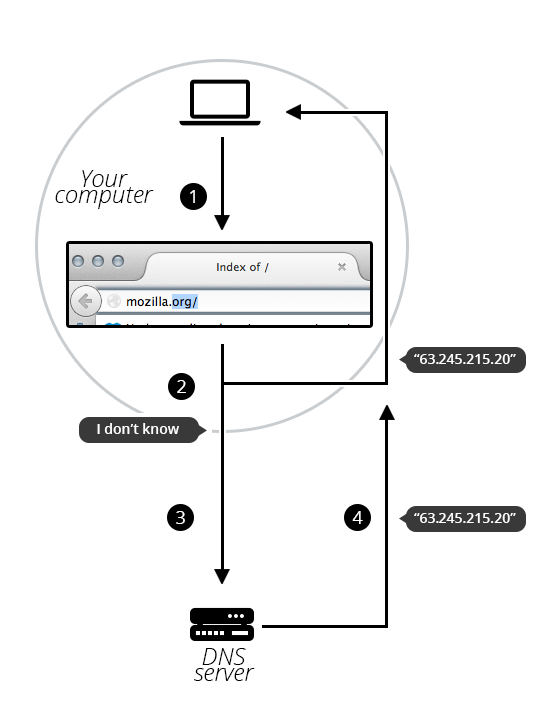

Todo
https://support.hostpoint.ch/en/products/domain/frequently-asked-questions/what-is-a-domain
https://developer.mozilla.org/en-US/docs/Learn_web_development/Howto/Web_mechanics/What_is_a_domain_name
https://www.cloudflare.com/en-gb/learning/dns/glossary/what-is-a-domain-name/
https://howdns.works/
https://www.cloudflare.com/en-gb/learning/dns/what-is-dns/
https://messwithdns.net/


## Domain Names & DNS 

Any Internet-connected computer can be reached through a public IP Address
    IPv4 address (e.g., 192.0.2.172)
    IPv6 address (e.g., 2001:db8:8b73:0000:0000:8a2e:0370:1337).

Computers can handle such addresses easily, but people have a hard time finding out who is running the server or what service the website offers. IP addresses are hard to remember and might change over time.

While each server has an IP address, since 72.14.205.100 doesn't roll off the tongue, we give them "Domain Names" like google.com.
That is, we alias an IP address with a human friendly domain name.

Domain names are a key part of the Internet infrastructure.

A domain or domain name is a unique, symbolic name or term for a specific area or sever on the internet. 
This name is entered by the end-user to access a specific website.

The Domain Name System (DNS) associates domain name with the corresponding IP addresses
like a phonebook associates names to phone numbers.


#### DNS Resolution

When a user wants to load a webpage, a translation must occur between domain name and IP address.
This process is called DNS resolution

DNS resolution converts a human-friendly hostname (such as www.example.com) into a computer-friendly IP address (such as 192.168.1.1). 


In order to understand the process behind the DNS resolution, it's important to learn about the different hardware components a DNS query must pass between. For the web browser, the DNS lookup occurs "behind the scenes" and requires no interaction from the user's computer apart from the initial request.

There are 4 DNS servers involved in loading a webpage:

    DNS recursor - The recursor can be thought of as a librarian who is asked to go find a particular book somewhere in a library. The DNS recursor is a server designed to receive queries from client machines through applications such as web browsers. Typically the recursor is then responsible for making additional requests in order to satisfy the client's DNS query.

    Root nameserver - The root server is the first step in translating (resolving) human readable host names into IP addresses. It can be thought of like an index in a library that points to different racks of books - typically it serves as a reference to other more specific locations.

    TLD nameserver - The top level domain server (TLD) can be thought of as a specific rack of books in a library. This nameserver is the next step in the search for a specific IP address, and it hosts the last portion of a hostname (In example.com, the TLD server is “com”).

    Authoritative nameserver - This final nameserver can be thought of as a dictionary on a rack of books, in which a specific name can be translated into its definition. The authoritative nameserver is the last stop in the nameserver query. If the authoritative name server has access to the requested record, it will return the IP address for the requested hostname back to the DNS Recursor (the librarian) that made the initial request.


When you enter a domain, a request will be sent to the corresponding name server. The name server searches its database for the correct IP address of this domain and responds. The browser can then display the desired website. This usually happens within milliseconds.


### Structure of domain names

A domain name has a simple structure made of several parts (it might be one part only, two, three…), separated by dots and read from right to left:


Each of those parts provides specific information about the whole domain name.

#### TLD (Top-Level Domain).

    TLDs tell users the general purpose of the service behind the domain name. The most generic TLDs (.com, .org, .net) don't require web services to meet any particular criteria, but some TLDs enforce stricter policies so it is clearer what their purpose is. For example:

        Local TLDs such as .us, .fr, or .se can require the service to be provided in a given language or hosted in a certain country — they are supposed to indicate a resource in a particular language or country.
        TLDs containing .gov are only allowed to be used by government departments.
        The .edu TLD is only for use by educational and academic institutions.

    TLDs can contain special as well as latin characters. A TLD's maximum length is 63 characters, although most are around 2–3.

    The full list of TLDs is maintained by ICANN.
    https://www.icann.org/resources/pages/tlds-2012-02-25-en

#### Label (or component)

    The labels are what follow the TLD. A label is a case-insensitive character sequence anywhere from one to sixty-three characters in length, containing only the letters A through Z, digits 0 through 9, and the '-' character (which may not be the first or last character in the label). a, 97, and hello-strange-person-16-how-are-you are all examples of valid labels.

    The label located right before the TLD is also called a Secondary Level Domain (SLD).

    A domain name can have many labels (or components). It is not mandatory nor necessary to have 3 labels to form a domain name. For instance, informatics.ed.ac.uk is a valid domain name. For any domain you control (e.g., mozilla.org), you can create "subdomains" with different content located at each, like developer.mozilla.org, support.mozilla.org, or bugzilla.mozilla.org.

### Who owns a domain name?

You cannot "buy a domain name". This is so that unused domain names eventually become available to be used again by someone else. If every domain name was bought, the web would quickly fill up with unused domain names that were locked and couldn't be used by anyone.

Instead, you pay for the right to use a domain name for one or more years. You can renew your right, and your renewal has priority over other people's applications. But you never own the domain name.

Companies called registrars use domain name registries to keep track of technical and administrative information connecting you to your domain name.

Note: For some domain name, it might not be a registrar which is in charge of keeping track. For instance, every domain name under .fire is managed by Amazon.

### Finding an available domain name

To find out whether a given domain name is available,

    Go to a domain name registrar's website. Most of them provide a "whois" service that tells you whether a domain name is available.

    Alternatively, if you use a system with a built-in shell, type a whois command into it, as shown here for mozilla.org:
```bash
whois mozilla.org
```

This will output the following:

```bash
Domain Name:MOZILLA.ORG
Domain ID: D1409563-LROR
Creation Date: 1998-01-24T05:00:00Z
Updated Date: 2013-12-08T01:16:57Z
Registry Expiry Date: 2015-01-23T05:00:00Z
Sponsoring Registrar:MarkMonitor Inc. (R37-LROR)
Sponsoring Registrar IANA ID: 292
WHOIS Server:
Referral URL:
Domain Status: clientDeleteProhibited
Domain Status: clientTransferProhibited
Domain Status: clientUpdateProhibited
Registrant ID:mmr-33684
Registrant Name:DNS Admin
Registrant Organization:Mozilla Foundation
Registrant Street: 650 Castro St Ste 300
Registrant City:Mountain View
Registrant State/Province:CA
Registrant Postal Code:94041
Registrant Country:US
Registrant Phone:+1.6509030800
```

As you can see, I can't register mozilla.org because the Mozilla Foundation has already registered it.

On the other hand, let's see if I could register afunkydomainname.org:
```bash
whois afunkydomainname.org
```
This will output the following (at the time of writing):
```bash
NOT FOUND
```
As you can see, the domain does not exist in the whois database, so we could ask to register it. Good to know!


### Getting a domain name

The process is quite straightforward:

    Go to a registrar's website.
    Usually there is a prominent "Get a domain name" call to action. Click on it.
    Fill out the form with all required details. Make sure, especially, that you have not misspelled your desired domain name. Once it's paid for, it's too late!
    The registrar will let you know when the domain name is properly registered. Within a few hours, all DNS servers will have received your DNS information.

Note: In this process the registrar asks you for your real-world address. Make sure you fill it properly, since in some countries registrars may be forced to close the domain if they cannot provide a valid address.

### DNS refreshing

DNS databases are stored on every DNS server worldwide, and all these servers refer to a few special servers called "authoritative name servers" or "top-level DNS servers" — these are like the boss servers that manage the system.

Whenever your registrar creates or updates any information for a given domain, the information must be refreshed in every DNS database. Each DNS server that knows about a given domain stores the information for some time before it is automatically invalidated and then refreshed (the DNS server queries an authoritative server and fetches the updated information from it). Thus, it takes some time for DNS servers that know about this domain name to get the up-to-date information.

### How does a DNS request work?

As we already saw, when you want to display a webpage in your browser it's easier to type a domain name than an IP address. Let's take a look at the process:

    Type mozilla.org in your browser's location bar.
    Your browser asks your computer if it already recognizes the IP address identified by this domain name (using a local DNS cache). If it does, the name is translated to the IP address and the browser negotiates contents with the web server. End of story.
    If your computer does not know which IP is behind the mozilla.org name, it goes on to ask a DNS server, whose job is precisely to tell your computer which IP address matches each registered domain name.
    Now that the computer knows the requested IP address, your browser can negotiate contents with the web server.




#### Who manages domains?

DNS was originally created to be an open and public communication protocol for government and educational institutions.

One DNS server can't handle requests from all devices. 
DNS servers are connected in a distributed hierarchy and are divided into zones, 
splitting up responsibility for the major domains such as .org, .com, .net, etc.

Domains are not assigned and managed by a centralized body, but are the result of an interplay between several people and organizations:

##### Registrant

The registrant is a person or organization that registers a domain name as an end customer. The registrant is therefore the owner of the domain name.

##### Registrar

The registrar is a company that registers the domain name with the relevant registry on behalf of the registrant and charges the registrant (end customer) the cost of doing so. The registrar shall ensure that the domain name complies with the specifications of the relevant registry.

##### Registry

The registry is a central registration body that manages one or more top-level domains. 

gTLD registries
As the name suggests, these organizations maintain generic extensions. Some of them like VeriSign (.com, .net) and Afilias (.info) have been around for a while. Others are either newly established companies or subsidiaries of existing ones. They manage the so-called new gTLDs. Branded TLDs like .google are an example of new extensions managed by a subsidiary of a larger existing company. Generic TLDs like .xyz or .tech are examples of extensions that are governed by newly created organizations.

##### National registries
These organizations are de jure independent, but they are usually government-led organizations that maintain the original country-code extensions like .de, .uk or .mx and new ones like .london. Country-code registries abide by the rules set by ICANN regarding the administration of top-level domains, but they also adopt country-specific policies that may be unique for a particular extension. If you want to register a .com.au domain name for example, you will need a valid Australian business number.

##### ICANN

ICANN (Internet Corporation for Assigned Names and Numbers) is a global non-profit organization and the world’s highest body for assigning and regulating domains. ICANN ensures that each domain exists only once, is unique and accessible, and regulates management and coordination of the Domain Name System (DNS).

ICANN is also responsible for the accreditation of registrars who wish to register domain names with generic top-level domains. To be accredited by ICANN, a registrar must undergo a process and meet certain security and stability requirements.


https://www.icdsoft.com/blog/who-is-who-in-the-domain-name-industry/
