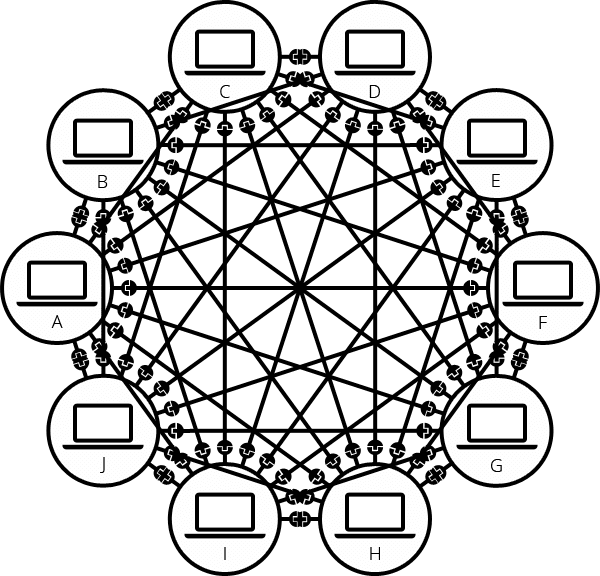
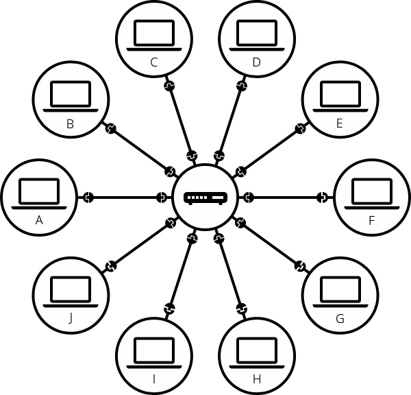
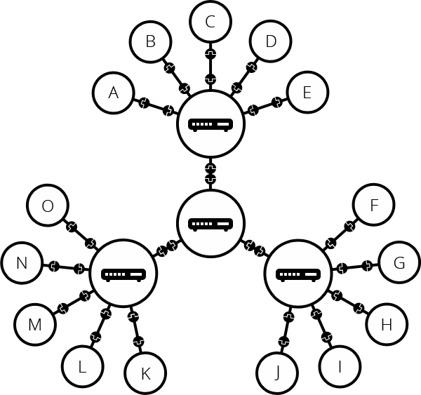
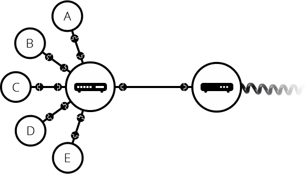
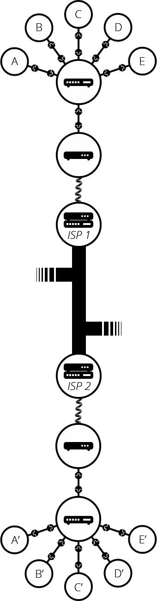
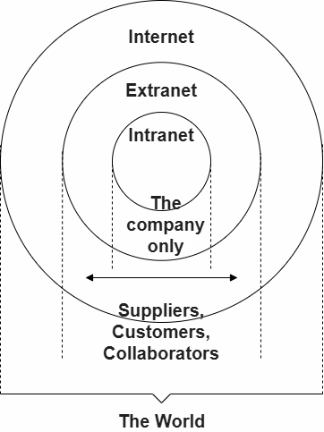
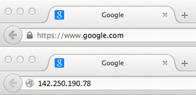

# Intro to the Internet

The Internet is a global network of computers which communicate through a standardized set of protocols.

Though the various technologies that support the Internet have evolved over time, the way it works hasn't changed much: Internet is a way to connect computers and ensure that, whatever happens, they find a way to stay connected.

The internet isn't owned by a single entity or organization, but is a network of networks that exchange traffic with each other based on voluntary interconnection agreements.

## Intro to Internet Infrastructure

### Keyterms

    Internet: the technical infrastructure composing the largest computer network in the world
    Network: a group of devices that are connected and share data
    Transmission media: a communication channel, wired or wireless, that carries data across a network
    Local Area Network (LAN): a network composed of devices that are physically close together within a limited geographic area
    Switch: A device that directs data between physically connected devices on a local area network
    Access Point: A device that directs data between wirelessly connected devices on a local area network
    Router: A device that directs data between different networks.
    Modem: A device that connects local networks to the internet by translating digital signals into analog signals 
    ISP: a company that manages telecom infrastructure to provide internet access to consumers and businesses
    Wide Area Network (WAN) span a large geographical area, connecting devices at different locations 
    Host: A computing device connected to, or "on", a network.
    Topology: physical and logical arrangement of network connections on a network
    Server: A Host that provides information or services on a network
    Client: A Host that requests information or services on a network
    Client–Server model: distributed application structure that partitions tasks or workloads between service providers and requesters.
    Distributed System: a collection of independent computers that work together across a network to achieve a common goal
    Decentralized Network: a network where control and data are spread out across many points, rather than managed by a single authority
    Internet Engineering Task Force: organization that manages open standards that assist in ensuring the internet remains efficient

### How Computers are Linked

At its most basic, the Internet is the largest computer network ever.

A computer network is a system that links two or more computing devices.
Networks enable information transfer or communication through the transmission of data between devices.

#### Transmission Media

Transmission media refer to the pathways through which data is shared from one device to another, within a network. 
Transmission media are either physical or wireless.
All transmission media harnesses some form of signal propagation.

Physical transmission media generally propagate signal energy over some type of cable, or wire.
An example of physical transmission media are ethernet cables used to connect PCs to other devices.

Wireless transmission media generally propagate signal energy using a transmitter broadcasting and receiver detecting electromagnetic waves.
An example of Wireless transmission media are wifi signals used to connect mobile devices.

### How The Internet Is Organized

When two computers communicate, at minimum, they must be linked via some transmission media.

Such a basic network is not limited to two computers. 
You can connect as many computers as you wish, however things get complicated quickly.
To connect ten computers, you need 45 cables, with nine plugs per computer!

To solve this problem, each computer on a network is connected to a computer called a router. This router has only one job: like a signaler at a railway station, it makes sure that a message sent from a given computer arrives at the right destination computer. To send a message to computer B, computer A must send the message to the router, which in turn forwards the message to computer B and makes sure the message is not delivered to computer C.

Once we add a router to the system, our network of 10 computers only requires 10 cables: a single plug for each computer and a router with 10 plugs.

A single router cannot scale to connect billions of computers.
But a router is a computer like any other, so we can connect routers together.
By connecting computers to routers, then routers to routers, we are able to scale.

Borrowing hardware from the telephone industry, connections within the same geographical location, like a home or office building, are often managed by switches.
Person computers may be connected directly to a router or may be connected to a network switch that is then connected to a router.
A network switch connects devices within a local area and forwards data to and from those devices and the router.

As technology has evolved and wireless connection became possible, another piece of hardware, the access point was developed.
Computers are connected physically to a switch via some type of physical wire.
Computers are connected wirelessly to an access point via radio waves.

The router is required to connect smaller networks utilizing switches to the internet, and anywhere two or more networks intersect there's a router.
Every time you visit a website upwards of ten to fifteen routers may help data find its way to and from your computer.

Such a network comes very close to what we call the Internet, but we're missing something. It's not really possible to set cables up between your house and the rest of the world, so how can you handle this? Hardware is again borrowed from the telephone industry, telecom infrastructure already connects your house with anyone in the world. To connect our network to the telephone infrastructure, we need a special piece of equipment called a modem. This modem turns the information from our network into information manageable by the telephone infrastructure and vice versa.

So we are connected to the telephone infrastructure. The next step is to send the messages from our network to the network we want to reach. To do that, we will connect our network to an Internet Service Provider (ISP). An ISP is a company that manages some special routers that are all linked together and can also access other ISPs' routers. So the message from our network is carried through the network of ISP networks to the destination network. The Internet consists of this whole infrastructure of networks.

The Internet is a vast, sprawling network of networks, an incredibly large number of independently operated segments. 
In fact, the word "Internet" could be said to come from this concept: interconnected networks.

### Where is the internet?

The internet has three basic parts:

#### The last mile, the LANs

the part of the internet that connects homes and businesses to the internet. Currently, about 60 percent of residential internet connections in the United States are provided by cable TV companies such as Comcast and Time Warner. Of the remaining 40 percent, a growing fraction use new fiber optic cables, most of which are part of Verizon's FiOS program or AT&T's U-Verse. Finally, a significant but shrinking number use outdated DSL service provided over telephone cables.
The last mile also includes the towers that allow people to access the internet with their cell phones. Wireless internet service accounts for a large and growing share of all internet usage.
The last mile is primarily composed of Local Area Networks (LAN) 
A LAN is composed of devices that are physically close together within a limited geographic area.
LANs are small networks, those found in homes or office buildings, that compose the edges of the broader internet.
LANs utilize switches to connect constituent devices, and typically require a single router to connect those devices to the broader Internet.

#### Data centers

rooms full of servers that store user data and host online apps and content. Some are owned by large companies such as Google and Facebook. Others are commercial facilities that provide service to many smaller websites. Data centers have very fast internet connections, allowing them to serve many users simultaneously. Data centers can be located anywhere in the world, but they are often located in remote areas where land and electricity are cheap. For example, Google, Facebook, and Microsoft have all constructed vast data centers in Iowa.

#### The backbone and WANs

The Internet backbone consists of high-capacity, long-distance networks that utilized large fiber-optic cables that carry data between major data centers, ISPs, and other network hubs. It forms the core infrastructure of the Internet, and facilitates communication between data centers and consumers, enabling global data transmission.

The backbone market is highly competitive. Backbone providers frequently connect their networks together at Internet Exchange Points (IXPs), usually located in major cities. Establishing a presence at IEPs makes it much easier for backbone providers to improve their connections to others.

Wide Area Network (WAN) span a large geographical area, connecting devices at different locations like multiple office branches of a company across cities or countries, allowing them to communicate with each other over the internet.

A WAN will encompass multiple LANs and thus include multiple routers and switches.
A WAN will typically utilize the services of an ISP to connect geographically separate locations.
While WANs cover large geographical areas, and may utilize the internet backbone to connect it's various segments, WANs are owned and managed by specific organizations or entities while the internet backbone is owned and managed by major telecommunications companies, ISPs, and backbone providers.
 
### Who runs the internet?

No one runs the internet. It's organized as a decentralized network of networks. Thousands of companies, universities, governments, and other entities operate their own networks and exchange traffic with each other based on voluntary interconnection agreements.

Began in the 1960s as a US-army-funded research project by the United States Department of Defense as a means of creating a decentralized communication network that could withstand a nuclear attack. 

In the 1980s the Internet transitioned into a public infrastructure with the support of many public universities and private companies.

Today, the system is fully distributed. There's no central control that's deciding how data is routed or where pieces of network are built, 
or even who interconnects with whom. These are all business decisions that are made independently by the operators. They are all motivated to assure that there is end-to-end connectivity of every part of the network, because the utility of the net is that any device can communicate with any other device, just like you want to be able to make phone calls to any other telephone in the world. 

The Internet's distributed nature makes it resilient. Any computer or hardware that can send and receive data in the correct fashion (e.g. using the correct networking protocols) can be part of the Internet. Pieces of networking hardware connect and disconnect from the Internet all the time without impacting how the Internet functions — unlike a computer, which may not function at all if it is missing a component. This applies even at a large scale: if a server, an entire data center, or an entire region of data centers goes down, the rest of the Internet can still function (if more slowly).

The shared technical standards that make the internet work are managed by an organization called the Internet Engineering Task Force. The IETF is an open organization; anyone is free to attend meetings, propose new standards, and recommend changes to existing standards. No one is required to adopt standards endorsed by the IETF, but the IETF's consensus-based decision-making process helps to ensure that its recommendations are generally adopted by the internet community.

### Intranets and Extranets

Intranets are private networks that are restricted to members of a particular organization. They are commonly used to provide a portal for members to securely access shared resources, collaborate and communicate. For example, an organization's intranet might host web pages for sharing department or team information, shared drives for managing key documents and files, portals for performing business administration tasks, and collaboration tools like wikis, discussion boards, and messaging systems.

Extranets are very similar to Intranets, except they open all or part of a private network to allow sharing and collaboration with other organizations. They are typically used to safely and securely share information with clients and stakeholders who work closely with a business. Often their functions are similar to those provided by an intranet: information and file sharing, collaboration tools, discussion boards, etc.

Both intranets and extranets run on the same kind of infrastructure as the Internet, and use the same protocols. They can therefore be accessed by authorized members from different physical locations.

## Intro to Network Protocols

### Keyterms

  Protocol: a set of rules that govern the format and methods by which data is transmitted.
  Packet: A most basic unit of data transmitted over a network
  Internet Protocol (IP): An addressing protocol that routes data packets through networks, from source to destination
  IP Address: A unique identifier assigned to each device on a network.
  DHCP: Network management protocol used to automate the process of configuring devices on IP networks.
  MAC address: permanent, unique identifier assigned to a network interface card (NIC) or network adapter a device uses to connect to a LAN.
  Local Network Segment: classification of networked devices that communicate without needing to pass through a intermediary router.
  ARP: Network communication protocol that matches IP addresses to MAC addresses.
  Domain Name: A human-readable name that is used to identify a website, such as google.com.
  DNS: The Domain Name System is responsible for translating domain names into IP addresses.

### What are Protocols

Connecting two computers, both of which may use different hardware and run different software, is one of the main challenges that the creators of the Internet had to solve. It requires the use of communications techniques that are understandable by all connected computers, just as two people, who may have little in common otherwise, can speak a common language to understand each other.

This problem is solved with protocols. 

In networking, a protocol is a standardized way of formatting and transmitting data so that any connected devices are able to communicate with and understand each other.

One of the key benefits of using standardized protocols is that they allow devices and systems from different manufacturers and vendors to communicate with each other seamlessly.

To ensure that data is sent and received correctly, the internet uses a variety of protocols.
Because all Internet-connected computers and other devices can interpret and understand these protocols, the Internet works no matter who or what connects to it.

The internet is really a design philosophy and an architecture expressed in a set of protocols. 

How an individual segment of the internet is physically structured is less important than the fact that this design philosophy has allowed the internet to adapt and absorb new communication technologies. This is because in order for a new technology to use the internet in some fashion, it just needs to know a specified set of protocols. 

###  Internet Protocol (IP)

To communicate between devices on a network, we specify what to transfer between them and which computers to transfer between.

#### Packets

A network packet is the unit of data carried by a "packet-switched" network.

Packet switching: the technique for dividing information into message blocks that each get routed separately, and assembled on the other side. The distributed nature and error correction allowed by packet switching make communication across the internet possible.

Instead of transferring files as single, uninterrupted data blocks, sending it in smaller packets enables computers to share connections.

Each packet is treated as an independent entity, unaffected by the other packets it is transmitted alongside.

Packets from simultaneous connections are interspersed, to support concurrent connections.

If there is a problem with the transmission of one or more packets, only those packets are retransmitted, rather than the entirety of a larger file.

#### Packet Structure

A packet has two parts, header and payload.
The packet header contains information, known as metadata, that helps the packet get to its destination.
The payload is the actual data being transmitted. 
The payload is encapsulated within the packet and follows the header.
This can be any type of data, such as part of an email, a web page, a video stream, or any other type of digital information. 

#### IP Address

Every network host has a unique address that identifies it, called an "IP address".
similar to a unique postal address used by the postal service.

IP addresses have a uniform format, composed of numeral groups in an ordered hierarchy. 
Generally, earlier numbers usually identify the country and regional network of the device, while later numbers identify the subnetwork, and finally the address of the specific device.

The source IP address identifies which device data originates from.
The destination IP address identifies which device data travels to.
Each packet keeps track of it's source IP and destination IP in their header.

#### Hosts

A network host, or simply a host, is a device connected to a computer network, assigned at least one network address.
A computer participating in networks that use the Internet Protocol suite may be referred to as an IP host. 
Specifically, computers participating in the Internet are called Internet hosts.

Network hosts can be further divided into specialized categories based on their role on the network

A simplified diagram of how internet hosts interact:

Once a connection is established, data can be transferred between the applications running on each device.
Clients send requests to a server, which processes these requests, performs necessary tasks to generate a response, and return the response to the client. The client receives the server's response, displays the results to the user, and awaits the users next request.

    Clients are the typical web user's internet-connected devices (for example, your computer connected to your Wi-Fi, or your phone connected to your mobile network) and web-accessing software available on those devices (usually a web browser like Firefox or Chrome).

    Servers are computers that store webpages, sites, or apps as files on server hard drives. When a client wants to access a webpage, they make a request to a server for a copy of the documents and assets that comprise the webpage, downloading them from the server onto the client machine to be rendered by the browser and displayed to the user.

#### Server 

Typically, a server is a computer connected directly to the Internet
Servers provide data, services, or applications to other hosts on the network. 
This data can be sent out to whichever hosts the server happens to be serving.

Servers can be web servers, cloud servers, virtual hosts... any thing providing services to computers over the internet 
or even part of a mainframe computer environment, providing services to attached workstations.

#### Client

A client is a host indirectly connected to the internet via an ISP.
A client is responsible for interacting with end users. 

### Dynamic Host Configuration Protocol (DHCP)

If connected to a network, a host has a unique IP address.

If you connect to the Internet through an ISP, you are usually assigned a temporary IP address for the duration of your session. 

Dynamic IPs are obtained from a DHCP (Dynamic Host Configuration Protocol) server.

By using DHCP, both your computer and router can automatically obtain the necessary IP addresses and network configuration parameters, ensuring seamless connectivity within the local network and to the Internet.

DHCP is a network management protocol used to automate the process of configuring devices on IP networks. 

### Address Resolution Protocol (ARP)

Address Resolution Protocol (ARP) is a network communication protocol that translates IP addresses to MAC addresses.

This translation is necessary because IP addresses change frequently, while MAC addresses are permanent.

A MAC (Media Access Control) address is a unique identifier assigned to a network interface card (NIC) the hardware component individual computers utilize to connect to a network.

Thus, MAC addresses identify devices within a local network segment.

A network of devices compose a local network segment when they can communicate with each other without needing to pass through a router.

local network segments utilize a switch to share data between computers.

There are several types of routers, but most routers pass data between LANs (local area networks) and WANs (wide area networks). 

ARP is the protocol by which devices on a local network segment are aware of and can communicate with each other, and ensures data is routed to the correct device.

Without ARP, devices on LANs would not be able to communicate with the switch they are connected by or the router connecting them to the internet.

### DNS 

To reach a website, we usually remember its name. 

While each server has a unique IP address, since 72.14.205.100 doesn't roll off the tongue, we give them Domain Names like google.com.
That is, we alias a computer-friendly IP address with a human readable domain name.

A domain or domain name is a unique, symbolic name or term for a specific area or sever on the internet. 
This name is entered by the end-user to access a specific website.

The Domain Name System (DNS) associates a domain name with the corresponding IP addresses through a process called DNS Resolution.
like a phonebook associates names to phone numbers.

### URL

Unique Resource Locators: (URLs) are the unique, human-friendly, addresses to web resources so that your browser can access them

Technically, web addresses that you type into the browser address bar form part of Uniform Resource Locators (URLs). URLs define the locations of unique resources on the internet.

A URL is a web address plus a protocol: for example, if you open a new tab in your browser, type in developer.mozilla.org into the address bar, and press Enter/Return, you will be redirected to a URL like the following one:

https://developer.mozilla.org/en-US/

The main parts of the URL are:

https

    The protocol being used to send the request. In this case, we are using HTTPS, which is a secure version of HTTP that stops bad people from reading your data while it is being transported. On the modern web, pretty much every server uses HTTPS, so if you don't include it explicitly, the browser assumes that is what you are using and adds it for you.
developer.mozilla.org

    The domain name of the URL, which represents the top-level location of the server you are connecting to. In this case, the web address you typed in is equal to the domain name, but this is not always the case — you could choose to type in a more complicated web address. Note that the developer part is a subdomain (distinct content area) of Mozilla's mozilla.org domain. There are other subdomains on Mozilla's site that host distinct content — see support.mozilla.org and bugzilla.mozilla.org, for example.
/en-US/

    The path to the resource on the server that you are accessing. MDN keeps all its US English content in a folder called en-US, which is what this URL is pointing to.

    If you have your browser set up to prefer English content by default, then this is the URL you will be redirected to when you type in developer.mozilla.org. If you have your browser set up to prefer a different language that MDN supports, such as French, you will be redirected to a different URL, such as https://developer.mozilla.org/fr/ instead. This isn't available to every website by default; the MDN developers have set MDN up like this to allow people to easily access the language they prefer.

 

 

### TCP

#### Keyterms

 Ports: Ports are used to identify the application or service running on a device. 
 Sockets: A socket is a combination of an IP address and a port number, representing a specific endpoint for communication. Sockets are used to establish connections between devices and transfer data between applications.
 Connections: A connection is established between two sockets when two devices want to communicate with each other. 

### SSL/TLS

SSL/TLS: The Secure Sockets Layer and Transport Layer Security protocols are used to provide secure communication over the internet.

SSL/TLS is a protocol used to encrypt data being transmitted over the internet. It is commonly used to provide secure connections for applications such as web browsers, email clients, and file transfer programs.

When using SSL/TLS to secure internet communication, there are a few key concepts to understand:

 Certificates: SSL/TLS certificates are used to establish trust between the client and server. They contain information about the identity of the server and are signed by a trusted third party (a Certificate Authority) to verify their authenticity.

 Handshake: During the SSL/TLS handshake process, the client and server exchange information to negotiate the encryption algorithm and other parameters for the secure connection.

 Encryption: Once the secure connection is established, data is encrypted using the agreed-upon algorithm and can be transmitted securely between the client and server.

When building internet-based applications and services, it's important to understand how SSL/TLS works and to ensure that your application is designed to use SSL/TLS when transmitting sensitive data such as login credentials, payment information, and other personal data. You'll also need to ensure that you obtain and maintain valid SSL/TLS certificates for your servers, and that you follow best practices for configuring and securing your SSL/TLS connections. By doing so, you can help protect your users' data and ensure the integrity and confidentiality of your application's communication over the internet.

### HTTP

HTTP (Hypertext Transfer Protocol) and HTTPS (HTTP Secure) are two of the most commonly used protocols in internet-based applications and services.

  HTTP: The Hypertext Transfer Protocol is used to transfer data between a client (such as a web browser) and a server (such as a website).
  HTTPS: An encrypted version of HTTP that is used to provide secure communication between a client and server.

The HTTP protocol takes care of the information communication between the web browser and the web server to deliver documents so that the web browser can render it on the screen.

Clients and servers communicate by exchanging individual messages (as opposed to a stream of data). The messages sent by the client are called requests and the messages sent by the server as an answer are called responses.

When you visit a website, your web browser sends an HTTP request to the server, asking for the webpage or other resource you've requested. The server then sends an HTTP response back to the client, containing the requested data.

HTTP is a protocol for fetching resources such as HTML documents. It is the foundation of any data exchange on the Web and it is a client-server protocol, which means requests are initiated by the recipient, usually the Web browser. A complete document is typically constructed from resources such as text content, layout instructions, images, videos, scripts, and more.

A single Web document can be composed from multiple resources from different servers.

HTTP uses a simple language of verbs to perform actions such as making requests (see HTTP request methods). The HTTP GET method is the one normally used to make HTTP requests of the type described above. For example, a request for the MDN home page might look like this:
http

GET /en-US/ HTTP/2

Host: developer.mozilla.org

The response sent by the server might looks something like this:
http

HTTP/2 200

date: Tue, 11 Feb 2025 11:13:30 GMT
expires: Tue, 11 Feb 2025 11:40:01 GMT
server: Google frontend
last-modified: Tue, 11 Feb 2025 00:49:32 GMT
etag: "65f26b7f6463e2347f4e5a7a2adcee54"
content-length: 45227
content-type: text/html

<!doctype html> ... (the 45227 bytes of the requested web page HTML)

The full response is more complex than this, but we have omitted most of it for brevity. The main parts are as follows:

HTTP/2 200

    The version of HTTP that the server is using to send the response, in this case HTTP/2, followed by a status code indicating whether the request was successful. 200 indicates success.
date, expires, etc.

    HTTP headers containing additional information about the response (note that requests can have headers too), which provide extra information and/or modify its behavior.
<!doctype html>, etc.

    The response body, which in this case contains the MDN homepage's HTML document.

#### Other status codes

Above, we met the 200 status code, which indicates that the HTTP request was successful. There are many HTTP status codes with specific meanings and uses, but you will only commonly see a few:

301

    The requested resource has been permanently moved to a new location, which is provided in the response. This is used for redirecting content when it's moved.
400

    The server can't process the request. This usually happens when the request isn't in a format the server understands, or has errors in it.
403

    The server will not give the client access to the requested resource. This usually happens when the server knows who the client is, but they don't have permission to access the requested page.
404

    The server cannot find the requested resource. This status is commonly returned if the URL is wrong or if content is deleted without putting a redirect in place.
503

    The request cannot be handled due to a problem with the server. This is common when servers are offline for maintenance, and it's expected to be temporary.

#### HTTPS

HTTPS is a more secure version of HTTP, which encrypts the data being transmitted between the client and server using SSL/TLS (Secure Sockets Layer/Transport Layer Security) encryption. This provides an additional layer of security, helping to protect sensitive information such as login credentials, payment information, and other personal data.

When you visit a website that uses HTTPS, your web browser will display a padlock icon in the address bar, indicating that the connection is secure. You may also see the letters “https” at the beginning of the website address, rather than “http”.

### Summary

In order for data to get back and forth between clients and servers, we need the following things:

    Your internet connection: Allows you to send and receive data on the internet.

    TCP/IP: Transmission Control Protocol and Internet Protocol (TCP/IP) are communication protocols that define how data should travel across the internet.

    DNS: The Domain Name System (DNS) is like an address book for websites. When you type a web address in your browser, the browser looks at the DNS to find the website's IP address — the actual address the server is located at — before it can retrieve the website. The browser needs to find out which server the website lives on, so it can send HTTP messages to the right place.

    HTTP: Hypertext Transfer Protocol (HTTP) is an application protocol that defines a language for clients and servers to speak to each other.

    Files: A website is made up of many different files. These files come in two main types:
        Code: Websites are built primarily from HTML, CSS, and JavaScript — the different programming languages websites are written in, which the browser interprets and assembles into a web page to display to a user.
        Assets: This is a collective term for all the other items that appear on a website — such as images, music, video, Word documents, and PDFs — that aren't code that the browser interprets.

When you type a web address into your browser address bar, the following steps occur:

  1. The browser goes to the DNS server and finds the IP address of the server that the website lives on.
  2. The browser sends an HTTP request message to the server, asking it to send a copy of the website to the client. This message, and all other data sent between the client and the server, is sent across your internet connection using TCP/IP.
  3. If the server approves the client's request, the server sends the client a "200 OK" message, which means "Of course you can look at that website! Here it is", and then starts sending the website's files to the browser as a series of small chunks called data packets.
  4. The browser assembles the small chunks into a complete web page and displays it to you.

Consider this article. In order for you to see it, it was sent over the Internet and utilized several protocols to ensure successful communication and data transfer:

IP: Provides logical addressing and routing of data packets across the network.
ARP: Resolves the NICs MAC address to an IP address connecting the local network segment's router to the broader internet.
DHCP: Automatically assigns an IP address and other network configuration parameters to the computer and router connecting to an ISP 
DNS: Translates the webpage domain name into an IP address that the computer can use to locate the web server.
TCP: Establishes a reliable connection between the computer and the web server, ensuring ordered and error-checked delivery of data.
TLS: Provides encryption and secure communication between the computer and the web server (if HTTPS is used).
HTTP(S): Transfers web page data between the computer and the web server.

## Introduction to Network Layers

While a network user may only perceive that he
or she is using one computer program (like a Web browser) and one piece of hardware (like
a PC), these are only parts of a much larger puzzle. In order for even the simplest task to be
accomplished on a network, dozens of different components must cooperate, passing
control information and data to accomplish the overall goal of network communication.

The best way to understand any complex system is to break it down into pieces and then
analyze what they do and how they interact. The most logical approach for this is to divide
the overall set of functions into modular components, each of which is responsible for a
particular function. At the same time, we also need to define interfaces between these
components, which describe how they fit together. This enables us to simplify the
complexity of networking by approaching it in digestible chunks.

Networking technologies are most often compartmentalized in this manner by dividing their
functions into layers, each of which contains hardware and/or software elements. Each
layer is responsible for performing a particular type of task, as well as interacting with the
layers above it and below it. Layers are conceptually arranged into a vertical stack. Lower
layers are charged with more concrete tasks such as hardware signaling and low-level
communication; they provide services to the higher layers. The higher layers in turn use
these services to implement more abstract functions such as implementing user
applications.

### OSI Model

The OSI model is a seven-layer model that divides the complexity of network communications into seven smaller, more manageable parts, each responsible for a different aspect of the communication process.

According to the OSI model, the layers of the internet are: 
Physical Layer
Data Link Layer (Link Layer)
Network Layer
Transport Layer
Session Layer
Presentation Layer
Application Layer

The Application Layer being the topmost layer closest to the user and the Physical Layer being the lowest level responsible for physical transmission of data

A brief description of each layer of the OSI Model:

1. **Physical Layer**: This is the lowest layer of the OSI model and is responsible for the physical connection between devices. It deals with the transmission and reception of raw bit streams over a physical medium (e.g., cables, switches).

2. **Data Link Layer**: This layer is responsible for node-to-node data transfer and error detection and correction. It ensures that data transferred is free of errors. It includes protocols like Ethernet and PPP.

3. **Network Layer**: This layer is responsible for determining the best physical path for data to reach its destination. It handles packet forwarding, including routing through different routers. Protocols like IP (Internet Protocol) operate at this layer.

4. **Transport Layer**: This layer ensures complete data transfer. It provides error recovery and flow control. Protocols like TCP (Transmission Control Protocol) and UDP (User Datagram Protocol) operate at this layer.

5. **Session Layer**: This layer manages sessions between applications. It establishes, manages, and terminates connections between local and remote applications.

6. **Presentation Layer**: This layer translates data between the application layer and the network format. It is responsible for data encryption, compression, and translation.

7. **Application Layer**: This is the topmost layer and is closest to the end user. It provides network services directly to applications. Protocols like HTTP, FTP, SMTP, and DNS operate at this layer.

TCP Layers

The TCP/IP model is divided into four different layers:

    Application layer
    Transport layer
    Internet layer
    Network Access layer

Data moves from one layer to another.
Each layer performs a specific task on the data that is being transmitted over the network channel 
Each layer makes use of the services provided by the underlying lower layers, and provides services to the layer above it.

The above layers represents different layer of abstraction in a process.
In the case of data being sent, the process movies from top to bottom. 
In the case of data being received, the layers of the model work in reverse order.

Application Layer
    This layer provides network services directly to applications. 
    It is the closest layer to the end user and facilitates communication between software applications and lower layers.
    It handles high-level protocols, data representation, encoding, and dialog control.
    The application layer is the scope within which applications, or processes, create user data and communicate this data to other applications on another or the same host.
    Processes are addressed via ports which essentially represent services.
    
    It corresponds to the OSI model's Session, Presentation, and Application layers.
    Protocols include HTTP (Hypertext Transfer Protocol), FTP (File Transfer Protocol), SMTP (Simple Mail Transfer Protocol), DNS (Domain Name System), Telnet, SSH (Secure Shell).

Transport Layer
    This layer provides end-to-end communication services for applications by managing host-to-host communications on either the local network or remote networks separated by routers.
    It ensures complete data transfer and error recovery.
    It handles data segmentation, flow control, error detection and correction, and retransmission of lost data. 
    
    It corresponds to the OSI model's Transport layer.
    Protocols include TCP (Transmission Control Protocol), UDP (User Datagram Protocol).

Internet Layer
    This layer is responsible for logical addressing and routing of data packets across the network. It ensures that data packets are sent from the source to the destination across multiple networks.
    It handles packet forwarding, addressing, and routing. It corresponds to the OSI model's Network layer.
    Protocols include IP (Internet Protocol), ICMP (Internet Control Message Protocol), IGMP (Internet Group Management Protocol).

Network Interface Layer (Link Layer)
   Responsible for the physical transmission of data over a network. It includes the hardware and software technologies that connect devices to the network.
   Handles the physical addressing, data framing, and error detection. It corresponds to the OSI model's Physical and Data Link layers.
   Protocols include Ethernet, Wi-Fi, ARP (Address Resolution Protocol).

The TCP/IP model is a more simplified and practical framework compared to the OSI model, and it is the foundation of the modern Internet.

### Internet Protocol Suite

The Internet Protocol Suite, commonly known as TCP/IP, is a set of communication protocols used for the Internet and similar networks. It is organized into four abstraction layers, each with specific functions and protocols. Here is a detailed explanation of all parts of the Internet Protocol Suite:

#### 1. Application Layer
- **Description**: This layer provides network services directly to applications. It is the closest layer to the end user and facilitates communication between software applications and lower layers.
  It handles high-level protocols, data representation, encoding, and dialog control.
- **Protocols**:
  - **HTTP (Hypertext Transfer Protocol)**: Used for transferring web pages.
  - **HTTPS (HTTP Secure)**: An encrypted version of HTTP for secure communication.
  - **FTP (File Transfer Protocol)**: Used for transferring files.
  - **SMTP (Simple Mail Transfer Protocol)**: Used for sending emails.
  - **DNS (Domain Name System)**: Translates domain names into IP addresses.
  - **Telnet**: Provides remote login capabilities.
  - **SSH (Secure Shell)**: Provides secure remote login and other secure network services.

#### 2. Transport Layer
- **Description**: This layer provides end-to-end communication services for applications. It ensures complete data transfer and error recovery.
- **Function**: It handles data segmentation, flow control, error detection and correction, and retransmission of lost data.
- **Protocols**:
  - **TCP (Transmission Control Protocol)**: Provides reliable, ordered, and error-checked delivery of data.
  - **UDP (User Datagram Protocol)**: Provides a connectionless, lightweight protocol for fast, efficient transmission of data without guaranteed delivery.

#### 3. Internet Layer
- **Description**: This layer is responsible for logical addressing and routing of data packets across the network. It ensures that data packets are sent from the source to the destination across multiple networks.
- **Function**: It handles packet forwarding, addressing, and routing.
- **Protocols**:
  - **IP (Internet Protocol)**: Provides logical addressing and routing of packets.
  - **ICMP (Internet Control Message Protocol)**: Used for error reporting and diagnostic functions.
  - **IGMP (Internet Group Management Protocol)**: Manages multicast group memberships.

#### 4. Network Interface Layer (Link Layer)
- **Description**: This layer is responsible for the physical transmission of data over a network. It includes the hardware and software technologies that connect devices to the network.
- **Function**: It handles physical addressing, data framing, and error detection.
- **Protocols**:
  - **Ethernet**: A widely used LAN technology.
  - **Wi-Fi**: A wireless LAN technology.
  - **ARP (Address Resolution Protocol)**: Maps IP addresses to MAC addresses.

### Summary
The Internet Protocol Suite, or TCP/IP, is a comprehensive set of protocols that enable communication over the Internet and similar networks. It is organized into four layers, each with specific functions and protocols that work together to ensure reliable and efficient data transmission. Understanding these layers and their associated protocols is essential for network administrators, engineers, and anyone involved in network communication.

Types of Enterprise Computer Networks

    Open system: A system that is connected to the network and is ready for communication. 

    Closed system: A system that is not connected to the network and can’t be communicated with.

    LAN: A Local Area Network (LAN) is a network that covers a small area, such as an office or a home. LANs are typically used to connect computers and other devices within a building or a campus.

    WAN: A Wide Area Network (WAN) is a network that covers a large geographic area, such as a city, country, or even the entire world. WANs are used to connect LANs together and are typically used for long-distance communication.

    Cloud Networks: Cloud Networks can be visualized with a Wide Area Network (WAN) as they can be hosted on public or private cloud service providers and cloud networks are available if there is a demand. Cloud Networks consist of Virtual Routers, Firewalls, etc.

These are just a few basic concepts of computer networking. Networking is a vast and complex field, and there are many more concepts and technologies involved in building and maintaining networks. Now we are going to discuss some more concepts on Computer Networking.

    

Types of Computer Network Architecture

Computer Network falls under these broad Categories:

    Client-Server Architecture: Client-Server Architecture is a type of Computer Network Architecture in which Nodes can be Servers or Clients. Here, the server node can manage the Client Node Behaviour.

    Peer-to-Peer Architecture: In P2P (Peer-to-Peer) Architecture, there is not any concept of a Central Server. Each device is free for working as either client or server.

Node Vs Host

A node is a broader term that includes anything connected to a network, while a host requires an IP address. In other words, all hosts are nodes, but network nodes are not hosts unless they require an IP address to function. 

Network Topology

The Network Topology is the layout arrangement of the different devices in a network. 

Some types of network topologies are:

    Bus Topology: In bus topology all devices are connected to a single central cable called a bus. Data is sent along this cable and all devices share the same connection. Simple and cheap to set up but if the main cable fails the whole network goes down.

    Star Topology: In star topology all devices are connected to a central node called hub or switch. The hub controls the flow of data between devices. If one device fails the rest of the network is unaffected. But, if the central hub fails the whole network stops working.

    Ring Topology: In ring topology devices are connected in a circular loop with each device connected to two others. Data travels in one direction (or sometimes both) passing through each device until it reaches its destination. A failure in one device can affect the whole network.

    Mesh Topology: In mesh topology every device is connected to every other device in the network. It provides multiple paths for data so if one path fails another can take over.

    Tree Topology: Tree topology is the combination of star and bus topology. Tree topology is good for organizing large networks and allows for easy expansion.

    Hybrid Topology: Hybrid topology is the combination of two or more different topologies (like star and mesh). It is flexible and can be customized based on the network’s specific needs.

A lot of different kinds of hardware and infrastructure go into making the Internet work for everyone. Some of the most important types include the following:

    Routers forward packets to different computer networks based on their destination. Routers are like the traffic cops of the Internet, making sure that Internet traffic goes to the right networks.
    Switches connect devices that share a single network. They use packet switching to forward packets to the correct devices. They also receive outbound packets from those devices and pass them along to the right destination.
    Web servers are specialized high-powered computers that store and serve content (webpages, images, videos) to users, in addition to hosting applications and databases. Servers also respond to DNS queries and perform other important tasks to keep the Internet up and running. Most servers are kept in large data centers, which are located throughout the world.

### Subnet

#### Overview
- **Description**: A subnet, or subnetwork, is a logically segmented portion of a larger network. It divides a large network into smaller, more manageable sections, improving performance and security.
- **Function**: Subnets help organize and manage IP addresses within a network, allowing for efficient routing and reducing broadcast traffic.

#### How Subnets Work
- **IP Addressing**: Each device in a subnet is assigned a unique IP address. The IP address consists of two parts: the network portion and the host portion.
- **Subnet Mask**: A subnet mask is used to determine which part of an IP address is the network portion and which part is the host portion. It is a 32-bit number that masks an IP address and divides it into network and host addresses.
  - Example: For an IP address `192.168.1.10` with a subnet mask `255.255.255.0`, the network portion is `192.168.1` and the host portion is `10`.

#### Benefits of Subnetting
- **Improved Performance**: By reducing the size of broadcast domains, subnetting minimizes network congestion and improves overall performance.
- **Enhanced Security**: Subnets can isolate different segments of a network, providing an additional layer of security by controlling access between subnets.
- **Efficient IP Address Management**: Subnetting allows for better utilization of IP addresses, preventing wastage and ensuring that IP address space is used efficiently.

### Difference Between Network and Host Portions of a Subnet Mask

#### Network Portion
- **Description**: The network portion of an IP address identifies the specific network to which the device belongs. It is used by routers to determine the best path to route packets to their destination network.
- **Function**: It helps in identifying and routing data to the correct network. All devices within the same network share the same network portion in their IP addresses.
- **Determination**: The subnet mask determines how many bits of the IP address are used for the network portion. For example, in a subnet mask of `255.255.255.0` (or `/24`), the first 24 bits are the network portion.

#### Host Portion
- **Description**: The host portion of an IP address identifies the specific device within the network. It is unique to each device within the same network.
- **Function**: It allows for the identification and communication with individual devices within the network. Each device has a unique host portion in its IP address.
- **Determination**: The remaining bits of the IP address, after the network portion, are used for the host portion. For example, in a subnet mask of `255.255.255.0` (or `/24`), the last 8 bits are the host portion.

### Example
- **IP Address**: `192.168.1.10`
- **Subnet Mask**: `255.255.255.0` (or `/24`)
  - **Network Portion**: `192.168.1` (first 24 bits)
  - **Host Portion**: `10` (last 8 bits)

### Summary
- **Network Portion**: Identifies the network, shared by all devices within the same network, used for routing.
- **Host Portion**: Identifies the specific device within the network, unique to each device within the same network.

The subnet mask is crucial in dividing the IP address into these two portions, enabling efficient routing and communication within and between networks.

#### Subnetting Example
- **Class C Network**: Consider a Class C network with the IP address range `192.168.1.0/24`. This network can be divided into smaller subnets.
  - **Subnet 1**: `192.168.1.0/26` (subnet mask `255.255.255.192`)
    - Network Address: `192.168.1.0`
    - Broadcast Address: `192.168.1.63`
    - Usable IP Range: `192.168.1.1` to `192.168.1.62`
  - **Subnet 2**: `192.168.1.64/26` (subnet mask `255.255.255.192`)
    - Network Address: `192.168.1.64`
    - Broadcast Address: `192.168.1.127`
    - Usable IP Range: `192.168.1.65` to `192.168.1.126`

#### Summary
A subnet is a smaller, logical subdivision of a larger network, created to improve network performance, enhance security, and manage IP addresses efficiently. Subnetting involves dividing a network into smaller segments, each with its own unique IP address range and subnet mask.

A network switch is a hardware device that connects multiple devices within a network, allowing them to communicate with each other by intelligently directing data packets to their intended destination, essentially acting as a traffic controller for network traffic between connected devices like computers, printers, and servers; it operates at the data link layer (Layer 2) of the OSI model, using MAC addresses to identify devices and efficiently forward data packets only to the appropriate recipient. 

 Unlike a router, a switch only sends data to the single device it is intended for (which may be another switch, a router, or a user's computer), not to networks of multiple devices.

Routers select paths for data packets to cross networks and reach their destinations. Routers do this by connecting with different networks and forwarding data from network to network

 routers are necessary for an Internet connection, while switches are only used for interconnecting devices. Homes and small offices need routers for Internet access, but most do not need a network switch, unless they require a large amount of Ethernet* ports. However, large offices, networks, and data centers with dozens or hundreds of computers usually do require switches.

 Network switches can operate at either OSI layer 2 (the data link layer) or layer 3 (the network layer). Layer 2 switches forward data based on the destination MAC address (see below for definition), while layer 3 switches forward data based on the destination IP address. Some switches can do both.

Most switches, however, are layer 2 switches. Layer 2 switches most often connect to the devices in their networks using Ethernet cables. Ethernet cables are physical cables that plug into devices via Ethernet ports.

An unmanaged switch simply creates more Ethernet ports on a LAN, so that more local devices can access the Internet. Unmanaged switches pass data back and forth based on device MAC addresses.

A managed switch fulfills the same function for much larger networks, and offers network administrators much more control over how traffic is prioritized. They also enable administrators to set up Virtual LANs (VLANs) to further subdivide a local network into smaller chunks.

Network switches refer to MAC addresses in order to send Internet traffic to the right devices, not IP addresses.

IP addresses are used at layer 3, which means computers and devices all over the Internet use IP addresses for sending and receiving data, no matter which network they are connected to. All IP packets include their source and destination IP addresses in their headers, just as a piece of mail has a destination address and a return address.

In contrast, a MAC address is a permanent identifier for each piece of hardware, somewhat like a serial number. Unlike IP addresses, MAC addresses do not change. MAC addresses are used at layer 2, not layer 3 — which means they are not included in IP packet headers. In other words, MAC addresses are not part of Internet traffic. They are only used inside a given LAN.

Layer 2 network switches maintain a table in memory that matches MAC addresses to the switch's Ethernet ports. This table is called a Content Addressable Memory (CAM) table.

Suppose Computer A is connected to an Ethernet cable that plugs into the switch's Port 1, Computer B is connected to Port 2, and Computer C to Port 3. When data arrives for Computer A, the switch consults its CAM table, sees where Computer A is connected, and knows to forward Computer A-bound traffic at Port 1, not Ports 2 or 3.

The switch's CAM table would look something like this:
MAC address 	 Port 
Computer A's MAC address 	1
Computer B's MAC address 	2
Computer C's MAC address 	3

The switch's CAM table is stored in memory. If the switch is turned off, the table will disappear and the switch has to relearn the table when it is rebooted.

Now, suppose the switch was just turned on and has not yet created its CAM table. It does not know which ports Computers A, B, and C are connected to. It also does not know their MAC addresses.
 MAC address  	 Port 
? 	?
? 	?
? 	?

Suppose Computer A sends a message to Computer B. The switch takes the following steps to get the message to Computer B and start filling out its CAM table:

    It records Computer A's MAC address and the port its message came in on
    It forwards Computer A's message to all other computers on the network (except Computer A); this is known as "flooding"
    When Computer B replies, it records Computer B's MAC address and port as well

MAC address 	 Port 
Computer A's MAC address 	1
Computer B's MAC address 	2
? 	?

Now, the switch's CAM table knows where Computer A and Computer B are. It also knows their MAC addresses.

### Network Security

Ensuring the security of a network is crucial to protect data and resources from unauthorized access and attacks. Key aspects of network security include:

    Firewalls: Devices or software that monitor and control incoming and outgoing network traffic based on security rules.
    Encryption: The process of encoding data to prevent unauthorized access. Commonly used in VPNs, HTTPS, and secure email.
    Intrusion Detection Systems (IDS): Tools that monitor network traffic for suspicious activity and potential threats.
    Access Control: Mechanisms that restrict access to network resources based on user identity and role.
    Regular Updates and Patching: Keeping software and hardware up to date to protect against vulnerabilities.

