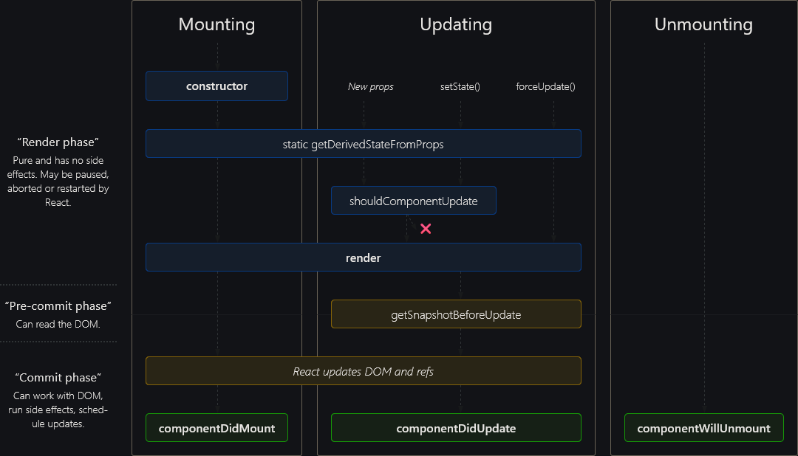

# Lifecycle

Phases of a React component's lifecycle

- **Mounting**: when an instance is created and inserted into the DOM. Only happens once, also called `initial render`
- **Updating**: when a component’s props or state change triggering a re-render.  
- **Unmounting**: when a component is removed from the DOM.  



In a class-based component, each phase has specific methods responsible for a particular stage in a component's lifecycle. 

These lifecycle methods are of course not applicable to functional components because they can only be written/contained within a class. However, React hooks give functional components the ability to use states via hooks. Hooks have gaining popularity because they make working with React cleaner and often less verbose. Simply put, React Hooks are functions that allow you to “hook into” a React state object and the lifecycle features within function components.


## Function Component Lifecycle

Function components in React do not have built-in lifecycle methods like class components; instead, all “lifecycle” behavior is handled via Hooks—chiefly useEffect (and useLayoutEffect)—which let you run code when a component mounts, updates, or unmounts. By varying the dependency array you pass to useEffect, you can replicate the behavior of componentDidMount, componentDidUpdate, and componentWillUnmount, and even fine-tune when and how often your effects run. Understanding these patterns is key to writing clean, predictable, and performant function components.

### Overview of Hooks-Based Lifecycle  

Function components are simple JavaScript functions returning JSX, React 16.8+ introduced state and side-effects via Hooks.  
The primary Hook for managing lifecycle-like behavior is `useEffect`, which runs after render and can optionally clean up before re-running or unmount.  
  
### 2. Mounting Phase  
When a component first appears (“mounts”) in the DOM, you often fetch data, subscribe to events, or perform imperative DOM work.  
To run an effect only once on mount, use an empty dependency array:  
```js
useEffect(() => {
  // Mount-only logic here
}, []);
```  
This pattern mirrors `componentDidMount` in classes but in a concise, functional form.

### 3. Updating Phase  
Whenever specified dependencies change, React re-runs the effect, letting you react to prop or state updates.  
```js
useEffect(() => {
  // Runs on mount and whenever `value` changes
}, [value]);
```  
Returning a cleanup function ensures previous effects are torn down before new ones start, preventing resource leaks or stale subscriptions.

### 4. Unmounting Phase  
When a component is removed from the DOM, the cleanup from any active effects runs automatically.  
```js
useEffect(() => {
  window.addEventListener('resize', handleResize);
  return () => {
    window.removeEventListener('resize', handleResize);
  };
}, []);
```  
This simulates `componentWillUnmount` without requiring class syntax.

### 5. Advanced Patterns and Best Practices  
- **`useLayoutEffect` vs. `useEffect`**: use layout effects for measurements before paint; standard effects after paint.  
- **Custom Hooks**: encapsulate related effects (e.g., `useDocumentTitle`, `useWebSocket`) for reuse and cleaner components.  
- **Dependency Management**: always list all reactive values in the dependency array; use `useMemo`/`useCallback` to avoid unnecessary re-runs.  
- **Separation of Concerns**: split complex logic into multiple `useEffect` calls rather than one monolithic effect.

---

### Sources  
1. React Docs: “Using the Effect Hook,” legacy.reactjs.org/docs/hooks-effect.html  ([Using the Effect Hook - React](https://legacy.reactjs.org/docs/hooks-effect.html?utm_source=chatgpt.com))  
2. LogRocket Blog: “Using React’s useEffect Hook with lifecycle methods,” blog.logrocket.com  ([Using React's useEffect Hook with lifecycle methods - LogRocket Blog](https://blog.logrocket.com/using-react-useeffect-hook-lifecycle-methods/?utm_source=chatgpt.com))  

4. GeeksforGeeks: “ReactJS useEffect Hook,” geeksforgeeks.org  ([ReactJS useEffect Hook - GeeksforGeeks](https://www.geeksforgeeks.org/reactjs-useeffect-hook/?utm_source=chatgpt.com))  
5. React.dev Reference: “useEffect,” react.dev/reference/react/useEffect  ([useEffect - React](https://react.dev/reference/react/useEffect?utm_source=chatgpt.com))  
6. Zipy.ai Blog: “A Guide to using useEffect Hook for React Lifecycle Methods,” zipy.ai  ([A Guide to using useEffect Hook for React Lifecycle Methods - Zipy.ai](https://www.zipy.ai/blog/using-reacts-useeffect-hook-with-lifecyle-methods?utm_source=chatgpt.com))  
7. StackOverflow: “React Hooks (Functional) Lifecycle…,” stackoverflow.com/questions/67129527  ([React Hooks (Functional) Lifecycle: Component rendered before ...](https://stackoverflow.com/questions/67129527/react-hooks-functional-lifecycle-component-rendered-before-useeffect-code?utm_source=chatgpt.com))  
8. LinkedIn Article: “React Functional Component Lifecycle,” linkedin.com  ([React Functional Component LifeCycle - LinkedIn](https://www.linkedin.com/pulse/react-functional-component-lifecycle-manikandan-b?utm_source=chatgpt.com))  
10. Medium: “React lifecycles with useEffect,” medium.com/@a.pouryousefi98  ([React lifecycles with useEffect - Medium](https://medium.com/%40a.pouryousefi98/react-lifecycles-with-useeffect-480e67d11eb2?utm_source=chatgpt.com))


Effect Lifecycle
3. React.dev: “Lifecycle of Reactive Effects,” react.dev/learn/lifecycle-of-reactive-effects  ([Lifecycle of Reactive Effects – React](https://react.dev/learn/lifecycle-of-reactive-effects?utm_source=chatgpt.com))  