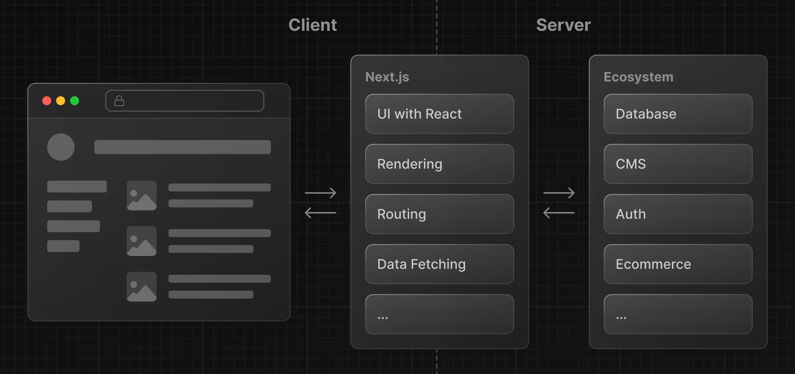

## What is Next.js?

Next.js is a React framework that gives you building blocks to create web applications.

By framework, we mean Next.js handles the tooling and configuration needed for React, and provides additional structure, features, and optimizations for your application.

Next.js streamlines the creation of an application’s frontend and backend. 

On the frontend, it uses React. It also adds native CSS modules to define styles, and custom Next.js modules to perform routing, image handling, and additional frontend tasks. 

The backend use a built-in server to provide the entry points for HTTP requests and a clean API in which to work with request and response objects.

You can use React to build your UI, then incrementally adopt Next.js features to solve common application requirements such as routing, data fetching, and caching - all while improving the developer and end-user experience.

### Built-in Next.js Components
Next.js provides a set of custom components. Each of these addresses one
specific use case: for example, accessing internal page properties such as
the page title or SEO metadata (next/head), improving the app’s overall ren-
dering performance and user experience (next/image), or enabling the appli-
cation’s routing (next/link). 