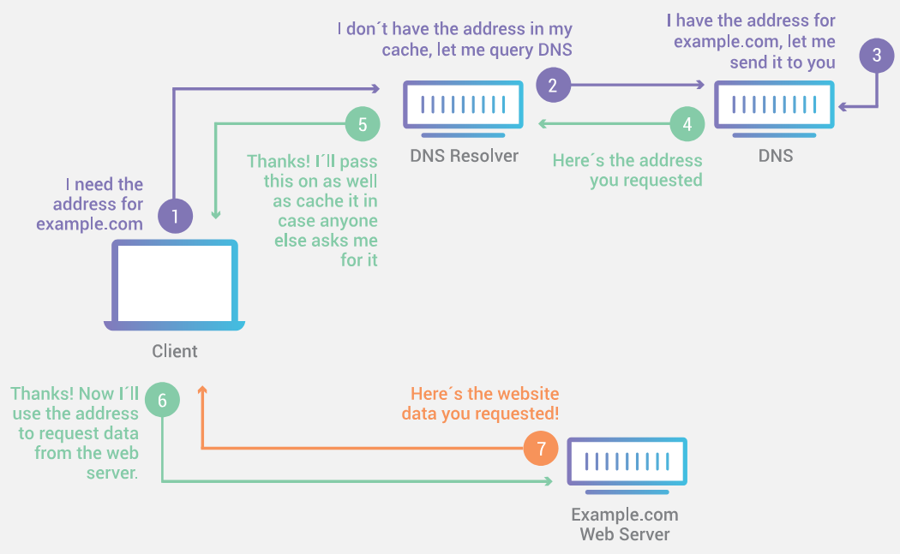

# Intro to the Internet

The Internet is a global network of computers which communicate through a standardized set of protocols.

Began in the 1960s as a US-army-funded research project by the United States Department of Defense as a means of creating a decentralized communication network that could withstand a nuclear attack. 

The Internet transitioned into a public infrastructure in the 1980s with the support of many public universities and private companies.

Over the years, it has evolved into a complex and sophisticated network that spans the globe.
Though the various technologies that support the Internet have evolved over time, the way it works hasn't changed much: Internet is a way to connect computers and ensure that, whatever happens, they find a way to stay connected.

## Intro to Internet Infrastructure

Keyterms

  Internet: the technical infrastructure that makes accessing the World Wide Web possible. 
  Network: a group of devices that are connected and share information and resources.
  Transmission media: a communication channel, wired or wireless, that carries the information across a network.
  from the sender to the receiver
  Router: A device that directs data between different networks.

At its most basic, the Internet is the largest network of computers ever made.

A computer network is a system that links two or more computing devices, enabling information transfer or communication through the transmission of data.

When two computers communicate, at minimum, they must be linked via some transmission media.

[Website Development\WebBasics\internet-schema-1.png]

Such a basic network is not limited to two computers. You can connect as many computers as you wish. However things get complicated quickly. To connect ten computers, you need 45 cables, with nine plugs per computer!

[Website Development\WebBasics\internet-schema-2.png]

To solve this problem, each computer on a network is connected to a computer called a router. This router has only one job: like a signaler at a railway station, it makes sure that a message sent from a given computer arrives at the right destination computer. To send a message to computer B, computer A must send the message to the router, which in turn forwards the message to computer B and makes sure the message is not delivered to computer C.

Once we add a router to the system, our network of 10 computers only requires 10 cables: a single plug for each computer and a router with 10 plugs.

[Website Development\WebBasics\internet-schema-3.png]

A single router cannot scale to connect billions of computers.
But a router is a computer like any other, so we can connect routers together.
By connecting computers to routers, then routers to routers, we are able to scale.

Anywhere two or more parts of the internet intersect there's a router.
Every time you visit a website upwards of ten to fifteen routers may help data find its way to and from your computer

[Website Development\WebBasics\internet-schema-4.png]

Such a network comes very close to what we call the Internet, but we're missing something. We built that network for our own purposes. There are other networks out there: your friends, your neighbors, anyone can have their own network of computers. But it's not really possible to set cables up between your house and the rest of the world, so how can you handle this? Well, there are already cables linked to your house, for example, electric power and telephone. The telephone infrastructure already connects your house with anyone in the world so it is the perfect wire we need. To connect our network to the telephone infrastructure, we need a special piece of equipment called a modem. This modem turns the information from our network into information manageable by the telephone infrastructure and vice versa.

[Website Development\WebBasics\internet-schema-5.png]

So we are connected to the telephone infrastructure. The next step is to send the messages from our network to the network we want to reach. To do that, we will connect our network to an Internet Service Provider (ISP). An ISP is a company that manages some special routers that are all linked together and can also access other ISPs' routers. So the message from our network is carried through the network of ISP networks to the destination network. The Internet consists of this whole infrastructure of networks

[Website Development\WebBasics\internet-schema-6.png]

The Internet is a vast, sprawling network of networks, an incredibly large number of independently operated segments. 

In fact, the word "Internet" could be said to come from this concept: interconnected networks.

It links billions of devices together all around the globe. So maybe you’re connected with a laptop or a phone through wifi, but then that wifi connection connects to an ISP connects you to billions and billions of devices around the world through hundreds of thousands of networks that are all interconnected.

Where is the internet?

The internet has three basic parts:

    The last mile
    the part of the internet that connects homes and small businesses to the internet. Currently, about 60 percent of residential internet connections in the United States are provided by cable TV companies such as Comcast and Time Warner. Of the remaining 40 percent, a growing fraction use new fiber optic cables, most of which are part of Verizon’s FiOS program or AT&T’s U-Verse. Finally, a significant but shrinking number use outdated DSL service provided over telephone cables.
    The last mile also includes the towers that allow people to access the internet with their cell phones. Wireless internet service accounts for a large and growing share of all internet usage.

    Data centers
    rooms full of servers that store user data and host online apps and content. Some are owned by large companies such as Google and Facebook. Others are commercial facilities that provide service to many smaller websites. Data centers have very fast internet connections, allowing them to serve many users simultaneously. Data centers can be located anywhere in the world, but they are often located in remote areas where land and electricity are cheap. For example, Google, Facebook, and Microsoft have all constructed vast data centers in Iowa.
    
    The backbone 
    consists of long-distance networks — mostly on fiber optic cables — that carry data between data centers and consumers. The backbone market is highly competitive. Backbone providers frequently connect their networks together at Internet Exchange Points, usually located in major cities. Establishing a presence at IEPs makes it much easier for backbone providers to improve their connections to others.

Who runs the internet?

No one runs the internet. It’s organized as a decentralized network of networks. Thousands of companies, universities, governments, and other entities operate their own networks and exchange traffic with each other based on voluntary interconnection agreements.

The system is fully distributed. There’s no central control that’s deciding how data is routed or where pieces of network are built, 
or even who interconnects with whom. These are all business decisions that are made independently by the operators. They are all motivated to assure that there is end-to-end connectivity of every part of the network, because the utility of the net is that any device can communicate with any other device, just like you want to be able to make phone calls to any other telephone in the world. 

The Internet's distributed nature makes it resilient. Any computer or hardware that can send and receive data in the correct fashion (e.g. using the correct networking protocols) can be part of the Internet. Pieces of networking hardware connect and disconnect from the Internet all the time without impacting how the Internet functions — unlike a computer, which may not function at all if it is missing a component. This applies even at a large scale: if a server, an entire data center, or an entire region of data centers goes down, the rest of the Internet can still function (if more slowly).

The shared technical standards that make the internet work are managed by an organization called the Internet Engineering Task Force. The IETF is an open organization; anyone is free to attend meetings, propose new standards, and recommend changes to existing standards. No one is required to adopt standards endorsed by the IETF, but the IETF’s consensus-based decision-making process helps to ensure that its recommendations are generally adopted by the internet community.

## Intro to Network Protocols

### Keyterms

  Network Protocol: a set of rules that govern how data is transmitted between devices on a network.
  Packet: A small unit of data that is transmitted over the internet.
  Internet Protocol (IP): An addressing protocol that routes data packets through networks from source to destination
  IP Address: A unique identifier assigned to each device on a network.
  Domain Name: A human-readable name that is used to identify a website, such as google.com.
  DNS: The Domain Name System is responsible for translating domain names into IP addresses.

### What are Protocols

Connecting two computers, both of which may use different hardware and run different software, is one of the main challenges that the creators of the Internet had to solve. It requires the use of communications techniques that are understandable by all connected computers, just as two people who grew up in different parts of the world may need to speak a common language to understand each other.

This problem is solved with standardized protocols. In networking, a protocol is a standardized way of doing certain actions and formatting data so that two or more devices are able to communicate with and understand each other.

There are protocols for sending packets between devices on the same network (Ethernet), for sending packets from network to network (IP), for ensuring those packets successfully arrive in order (TCP), and for formatting data for websites and applications (HTTP). In addition to these foundational protocols, there are also protocols for routing, testing, and encryption. And there are alternatives to the protocols listed above for different types of content — for instance, streaming video often uses UDP instead of TCP.

Because all Internet-connected computers and other devices can interpret and understand these protocols, the Internet works no matter who or what connects to it.

To ensure that data is sent and received correctly, the internet uses a variety of protocols.

The internet is really a design philosophy and an architecture expressed in a set of protocols. 

A protocol is a well-known set of rules and standards that, if all parties agree to use it, will allow them to communicate without trouble. 

One of the key benefits of using standardized protocols is that they allow devices and systems from different manufacturers and vendors to communicate with each other seamlessly. For example, a web browser developed by one company can communicate with a web server developed by another company, as long as they both adhere to a standardized protocol.

How an individual segment of the internet is physically structured is less important than the fact that this design philosophy has allowed the internet to adapt and absorb new communication technologies. This is because in order for a new technology to use the internet in some fashion, it just needs to know which protocols to work with. 

### Packets

As discussed above, the foundation of the internet is a global network of interconnected routers, responsible for directing traffic. 

Computers break data to be transferred into smaller, ordered pieces individually called a packet of information.
A packet, in networking terms, is the smallest functioning unit of data, and the basic building block of all network communication.

Packets are used for efficient and reliable transmission of data.
 
A packet has two parts. The header contains information that helps the packet get to its destination, including the length of the packet, its source and destination, and a checksum value that helps the recipient detect if a packet was damaged in transit. After the header comes the actual data. A packet can contain up to 64 kilobytes of data, which is roughly 20 pages of plain text.

If internet routers experience congestion or other technical problems, they are allowed to deal with it by simply discarding packets. It’s the sending computer’s responsibility to detect that a packet didn’t reach its destination and send another copy. This approach might seem counterintuitive, but it simplifies the internet’s core infrastructure, leading to higher performance at lower cost

#### Why Packets are Small

Instead of transferring files as single, uninterrupted data blocks, sending it in smaller packets enables multiple computers to share the same connection.

Packets are sent across the Internet using a technique called packet switching. Intermediary routers and switches are able to process packets independently from each other, without accounting for their source or destination. This is by design so that no single connection dominates the network. If data was sent between computers all at once with no packet switching, a connection between two computers could occupy multiple cables, routers, and switches for minutes at a time. Essentially, only two people would be able to use the Internet at a time — instead of an almost unlimited number of people, as is the case in reality.

A very large image file might be made up of tens of millions of bits or ones and zeros.
The computer sending the image can break it into hundreds or even thousands of packets. 
With packet switching, large files are broken down into individual packets.

Without packet-switched networks, the process of sending a large video file would take considerable time and could potentially clog the network with an uninterrupted data stream other transmissions would have to wait for.

If multiple transmissions are managed by a given router, packets from different transmissions may be interspersed, to support concurrent connections.
In this way, data exchanges consisting of smaller amounts of data may be completed at the same time larger file transfers are ongoing.

Each packet is treated as an independent entity, assigned with information, including the source, destination, and other information so they may be reassembled at the destination.

If there is a problem with the transmission of one or more packets, only those packets are requested to be retransmitted, rather than the entirety of a larger file.

#### How Packets Travel

Packets are initiated from source devices to a router. 
The router examines the packet and forwards it to the next router in the path towards its target.
This process continues until the packet reaches its destination device.

The data path, the order of routers used to transfer data across a network, may change in the midst of a computer-to-computer conversation. 

A packet travels from one place to another on the internet a lot like how you might get from one place to another in a car. 
Depending on traffic congestion or road conditions you might choose or be forced to take a different route to get to a desired location.

If one route is congested, individual packets may travel different routes through the internet and they may arrive at the destination at 
slightly different times, perhaps out of order. 

As part of the Internet Protocol, every router keeps track of multiple paths for sending packets.
Routers chooses the cheapest available path for each piece of data based on destination IP address for the packet. 
Cheapest in this case doesn’t mean cost but time and nontechnical factors such as politics and relationships between companies.
Often the best route for data to travel isn’t necessarily the most direct.

Having options for paths makes the network fault tolerant. 
This is the basis for a key principle of the internet: reliability. 

### IP

To communicate between devices on a network, we specify which ones. 

Every network host has a unique address that identifies it, called an "IP address" (where IP stands for Internet Protocol).
similar to a unique postal address

IP v4: 32 bit, 4 byte
[0-255].[0-255].[0-255].[0-255]

IP v6: 128 bit, 16 byte
[0-FFFF].[0-FFFF].[0-FFFF].[0-FFFF].[0-FFFF].[0-FFFF].[0-FFFF].[0-FFFF]

These numbers are arranged in a hierarchy 

The earlier numbers usually identify the country and regional network of the device. 
Then come the subnetwork, and finally the address of the specific device.

IPv4 was designed in 1973 and widely adopted in the early 80s
In 1974, the Institute of Electrical and Electronics Engineers (IEEE) published a paper entitled "A Protocol for Packet Network Intercommunication".
Authors Vint Cerf and Bob Kahn describe an internetworking protocol for sharing resources using packet switching among network nodes.
IPv4 provides 2^32, over 4 billion, unique addresses for devices connecting to the internet. 

A regional Internet registry (RIR) is an organization that manages the allocation and registration of Internet number resources within a particular region of the world. Internet number resources include IP addresses.
IPv4 address exhaustion is the depletion of the pool of unallocated IPv4 addresses, and began to be an issue for various RIRs in the 2010s

A longer IP address format called IPv6 was developed by the Internet Engineering Task Force (IETF) 
IETF began developing IPv6 in 1994, and the core specification was published in 1995.
IPv6 was ratified as the Internet Standard in 2017. 
IPv6 uses 128 bits per address and provides 2^128, over 340 undecillion, unique addresses.
That’s more than enough for every grain of sand on Earth to have its own IP address.

The source IP address determines where data originates from, while the destination IP address determines where the data is intended to travel.

To traverse the internet each packet is wrapped in several layers
the first layer is your computer's IP address
your computer sends the packet to the first router which adds its own IP address then sends it to the next router
each time the packet reaches a new router another layer is added until it reaches the destination, like a web server

When the server sends back information it creates packets with an identical wrapping as the packet makes its way over the internet back to your computer, each router unwraps a layer to discover where to send the response next until it reaches your computer

### DNS 

When we browse the Web with a Web browser, we usually use a name to reach a website. 

Since 72.14.205.100 doesn't roll off the tongue, we give them Domain Names like google.com or facebook.com

That is, we alias an IP address with a human readable name called a domain name.

The Domain Name System (DNS) is the phonebook of the Internet.
DNS associates names like www.example.com with the corresponding IP addresses.

web browsers and other software provide a domain name and rely on the DNS to look up domain names and get the associated IP address.

One DNS server can't handle requests from all devices. 
DNS servers are connected in a distributed hierarchy and are divided into zones, 
splitting up responsibility for the major domains such as .org, .com, .net, etc.

DNS was originally created to be an open and public communication protocol for government and educational institutions.

### DNS Resolution
The process of DNS resolution involves converting a hostname (such as www.example.com) into a computer-friendly IP address (such as 192.168.1.1). An IP address is given to each device on the Internet, and that address is necessary to find the appropriate Internet device - like a street address is used to find a particular home. When a user wants to load a webpage, a translation must occur between what a user types into their web browser (example.com) and the machine-friendly address necessary to locate the example.com webpage.

In order to understand the process behind the DNS resolution, it’s important to learn about the different hardware components a DNS query must pass between. For the web browser, the DNS lookup occurs "behind the scenes" and requires no interaction from the user’s computer apart from the initial request.

There are 4 DNS servers involved in loading a webpage:

    DNS recursor - The recursor can be thought of as a librarian who is asked to go find a particular book somewhere in a library. The DNS recursor is a server designed to receive queries from client machines through applications such as web browsers. Typically the recursor is then responsible for making additional requests in order to satisfy the client’s DNS query.
    Root nameserver - The root server is the first step in translating (resolving) human readable host names into IP addresses. It can be thought of like an index in a library that points to different racks of books - typically it serves as a reference to other more specific locations.
    TLD nameserver - The top level domain server (TLD) can be thought of as a specific rack of books in a library. This nameserver is the next step in the search for a specific IP address, and it hosts the last portion of a hostname (In example.com, the TLD server is “com”).
    Authoritative nameserver - This final nameserver can be thought of as a dictionary on a rack of books, in which a specific name can be translated into its definition. The authoritative nameserver is the last stop in the nameserver query. If the authoritative name server has access to the requested record, it will return the IP address for the requested hostname back to the DNS Recursor (the librarian) that made the initial request.

Ping

There is a handy program to see if a computer is connected to the Internet. 
The name comes from active sonar terminology that sends a pulse of sound and listens for the echo to detect objects under water

usage
$ ping www.yahoo.com

The ping utility sends a 'ping' (actually an ICMP (Internet Control Message Protocol) echo request message) to the named computer. 
The pinged computer will respond with a reply.
The ping program will count the time expired until the reply comes back (if it does). 
Also, if you enter a domain name (i.e. www.yahoo.com) instead of an IP address, ping will resolve the domain name and display the computer's IP address.

Traceroute

The traceroute utility shows the path your packets are taking to a given Internet destination. Like ping, you must use traceroute from a command prompt. In Windows, use tracert www.yahoo.com. From a Unix prompt,

usage
traceroute www.yahoo.com. 

Like ping, you may also enter IP addresses instead of domain names. Traceroute will print out a list of all the routers, computers, and any other Internet entities that your packets must travel through to get to their destination. 

you'll notice that your packets must travel through many things to get to their destination. Most have long names such as sjc2-core1-h2-0-0.atlas.digex.net and fddi0-0.br4.SJC.globalcenter.net. These are Internet routers that decide where to send your packets. 

If you are connected to the Internet, your computer has a unique IP address.

If you connect to the Internet through an Internet Service Provider (ISP), you are usually assigned a temporary IP address for the duration of your dial-in session. 

If you connect to the Internet from a local area network (LAN) your computer might have a permanent IP address or it might obtain a temporary one from a DHCP (Dynamic Host Configuration Protocol) server.

 
 Host: A computing device connected to, or "on", a network.
 Server: device or software that provides information or services on a network
 Client: device or software that requests information or services on a network
 Client–Server model: distributed application structure that partitions tasks or workloads between service providers and requesters.
 Ports: Ports are used to identify the application or service running on a device. 
 Sockets: A socket is a combination of an IP address and a port number, representing a specific endpoint for communication. Sockets are used to establish connections between devices and transfer data between applications.
 Connections: A connection is established between two sockets when two devices want to communicate with each other. During the connection establishment process, the devices negotiate various parameters such as the maximum segment size and window size, which determine how data will be transmitted over the connection.

Network Hosts

A network host is a device connected to a computer network, assigned at least one network address.
A computer participating in networks that use the Internet protocol suite may also be called an IP host. 
Specifically, computers participating in the Internet are called Internet hosts.
Internet hosts and other IP hosts have one or more IP addresses assigned to their network interfaces.

Network hosts can be further divided into specialized categories based on their role on the network

A server is a computer connected directly to the Internet
Servers provide data, services, or applications to other hosts on the network. 
For example, web pages are files on server hard drives.

A client is a host indirectly connected to the internet via an ISP.
A client is responsible for interacting with end users. 

Once a connection is established, data can be transferred between the applications running on each device.
Clients send requests to a server, which processes these requests, performs necessary tasks to generate a response, and returns the response to the client. The client receives the server's response, displays the results to the user, and awaits the users next request.

Consider this article. In order for you to see it, it was sent over the Internet piece by piece in the form of several thousand data packets.

The specific steps involved in this process are:

    DNS query: When your browser started to load this webpage, it likely first made a DNS query to find out the Cloudflare website's IP address.
    TCP handshake: Your browser opened a connection with that IP address.
    TLS handshake: Your browser also set up encryption between a Cloudflare web server and your device so that attackers cannot read the data packets that travel between those two endpoints.
    HTTP request: Your browser requested the content that appears on this webpage.
    HTTP response: Cloudflare's server transmitted the content in the form of HTML, CSS, and JavaScript code, broken up into a series of data packets. Once your device received the packets and verified it had received all of them, your browser interpreted the HTML, CSS, and JavaScript code contained in the packets to render this article about how the Internet works. The whole process took only a second or two.

TCP

TCP (Transmission Control Protocol) manages the sending and receiving of all your data as packets.

IP is a connectionless protocol, which means that each unit of data is individually addressed and routed from the source device to the target device, and the target does not send an acknowledgement back to the source. 

That’s where the TCP protocol comes in. 
TCP is used in conjunction with IP in order to maintain a connection between the sender and the target and to ensure packet order.

When an email is sent over TCP, a connection is established and a 3-way handshake is made. First, the source sends an SYN “initial request” packet to the target server in order to start the dialogue. Then the target server sends a SYN-ACK packet to agree to the process. Lastly, the source sends an ACK packet to the target to confirm the process, after which the message contents can be sent. The email message is ultimately broken down into packets before each packet is sent out into the Internet, where it traverses a series of gateways before arriving at the target device where the group of packets are reassembled by TCP into the original contents of the email.

Think of it like a guaranteed mail service. 
When you request data on your device, servers send many packets. 
When your packets arrive, TCP does a full inventory and sends back acknowledgments of each packet received. 
If all packets are there, TCP signs for your delivery and you’re done.

If TCP finds some packets are missing, it requests each missing or incomplete packet again. 
This continues until TCP verifies the delivery of all packets.

What’s great about the TCP and router systems is they’re scalable. 
They can work with eight devices or eight billion devices. 
In fact, because of these principles of fault tolerance and redundancy, the more routers we add, the more reliable the internet becomes. 
What’s also great is we can grow and scale the internet without interrupting service for anybody using it.

TCP/IP (Transmission Control Protocol/Internet Protocol) is the underlying communication protocol used by most internet-based applications and services. It provides a reliable, ordered, and error-checked delivery of data between applications running on different devices.

Each application or service is assigned a unique port number, allowing data to be sent to the correct destination.

TCP is a connection-oriented protocol that establishes a connection between two nodes before transmitting any data. All data sent over a TCP connection is checked for accuracy and retransmitted until the data is received correctly. This reliability makes TCP well-suited for applications that require a high degree of error-checking and for large data transfers. And also, TCP operates at the lowest level of the OSI model, transmitting data in segments, which are then reassembled into whole frames by the receiver.

TCP also provides congestion control, which helps prevent network congestion by regulating the rate at which data is sent. 
Additionally, TCP can control the flow of data, allowing data to be sent at different rates depending on the application's needs.

When building applications with TCP/IP, you’ll need to ensure that your application is designed to work with the appropriate ports, sockets, and connections. You’ll also need to be familiar with the various protocols and standards that are commonly used with TCP/IP, such as HTTP, FTP (File Transfer Protocol), and SMTP (Simple Mail Transfer Protocol).

 
The TCP/IP model is divided into four different layers:

    Application layer
    Transport layer
    Internet layer
    Network Access layer

Each layer performs a specific task on the data that is being transmitted over the network channel, and data moves from one layer to another

The above layers, from top to bottom, represents the flow of data when it is being transmitted from the sender side. In the case of data being received, the layers of the model work in reverse order.

Application Layer
    This layer provides network services directly to applications. It is the closest layer to the end user and facilitates communication between software applications and lower layers.
    It handles high-level protocols, data representation, encoding, and dialog control. It corresponds to the OSI model's Session, Presentation, and Application layers.
    Protocols include HTTP (Hypertext Transfer Protocol), FTP (File Transfer Protocol), SMTP (Simple Mail Transfer Protocol), DNS (Domain Name System), Telnet, SSH (Secure Shell).

Transport Layer
    This layer provides end-to-end communication services for applications. It ensures complete data transfer and error recovery.
    It handles data segmentation, flow control, error detection and correction, and retransmission of lost data. It corresponds to the OSI model's Transport layer.
    Protocols include TCP (Transmission Control Protocol), UDP (User Datagram Protocol).

Internet Layer
    This layer is responsible for logical addressing and routing of data packets across the network. It ensures that data packets are sent from the source to the destination across multiple networks.
    It handles packet forwarding, addressing, and routing. It corresponds to the OSI model's Network layer.
    Protocols include IP (Internet Protocol), ICMP (Internet Control Message Protocol), IGMP (Internet Group Management Protocol).

Network Interface Layer (Link Layer)
   Responsible for the physical transmission of data over a network. It includes the hardware and software technologies that connect devices to the network.
   Handles the physical addressing, data framing, and error detection. It corresponds to the OSI model's Physical and Data Link layers.
   Protocols include Ethernet, Wi-Fi, ARP (Address Resolution Protocol).

The TCP/IP model is a more simplified and practical framework compared to the OSI model, and it is the foundation of the modern Internet.

There are four main protocols used in TCP/IP: the Transmission Control Protocol (TCP), the User Datagram Protocol (UDP), the Internet Protocol (IP), and the Internet Control Message Protocol (ICMP).

    TCP ensures that data is delivered reliably and in order. 
    UDP is used for applications where data doesn't need to be delivered reliably or needs to be delivered quickly without the overhead of TCP.
    IP is the protocol that routes data from one computer to another. 
    ICMP is used for error-checking and for managing traffic congestion.

There are some other protocols also notable, and there are,

    Address Resolution Protocol (ARP)
    File Transfer Protocol (FTP)
    Hypertext Transfer Protocol (HTTP)
    Simple Mail Transfer Protocol (SMTP)
    Domain Name System (DNS)

HTTP

 HTTP: The Hypertext Transfer Protocol is used to transfer data between a client (such as a web browser) and a server (such as a website).
 HTTPS: An encrypted version of HTTP that is used to provide secure communication between a client and server.
 SSL/TLS: The Secure Sockets Layer and Transport Layer Security protocols are used to provide secure communication over the internet.

HTTP (Hypertext Transfer Protocol) and HTTPS (HTTP Secure) are two of the most commonly used protocols in internet-based applications and services.

HTTP is the protocol used to transfer data between a client (such as a web browser) and a server (such as a website).

Clients and servers communicate by exchanging individual messages (as opposed to a stream of data). The messages sent by the client are called requests and the messages sent by the server as an answer are called responses.

When you visit a website, your web browser sends an HTTP request to the server, asking for the webpage or other resource you’ve requested. The server then sends an HTTP response back to the client, containing the requested data.

HTTP is a protocol for fetching resources such as HTML documents. It is the foundation of any data exchange on the Web and it is a client-server protocol, which means requests are initiated by the recipient, usually the Web browser. A complete document is typically constructed from resources such as text content, layout instructions, images, videos, scripts, and more.

A single Web document composed from multiple resources from different servers.

HTTPS

HTTPS is a more secure version of HTTP, which encrypts the data being transmitted between the client and server using SSL/TLS (Secure Sockets Layer/Transport Layer Security) encryption. This provides an additional layer of security, helping to protect sensitive information such as login credentials, payment information, and other personal data.

When you visit a website that uses HTTPS, your web browser will display a padlock icon in the address bar, indicating that the connection is secure. You may also see the letters “https” at the beginning of the website address, rather than “http”.

SSL/TLS

SSL/TLS is a protocol used to encrypt data being transmitted over the internet. It is commonly used to provide secure connections for applications such as web browsers, email clients, and file transfer programs.

When using SSL/TLS to secure internet communication, there are a few key concepts to understand:

 Certificates: SSL/TLS certificates are used to establish trust between the client and server. They contain information about the identity of the server and are signed by a trusted third party (a Certificate Authority) to verify their authenticity.

 Handshake: During the SSL/TLS handshake process, the client and server exchange information to negotiate the encryption algorithm and other parameters for the secure connection.

 Encryption: Once the secure connection is established, data is encrypted using the agreed-upon algorithm and can be transmitted securely between the client and server.

When building internet-based applications and services, it’s important to understand how SSL/TLS works and to ensure that your application is designed to use SSL/TLS when transmitting sensitive data such as login credentials, payment information, and other personal data. You’ll also need to ensure that you obtain and maintain valid SSL/TLS certificates for your servers, and that you follow best practices for configuring and securing your SSL/TLS connections. By doing so, you can help protect your users’ data and ensure the integrity and confidentiality of your application’s communication over the internet.

Node Vs Host

A node is a broader term that includes anything connected to a network, while a host requires an IP address. In other words, all hosts are nodes, but network nodes are not hosts unless they require an IP address to function. Hosts use various protocols to communicate, including TCP and User Datagram Protocol (UDP).

File Transfer Protocol (FTP): A reliable protocol for sending and receiving files 
User Datagram Protocol (UDP): A connectionless protocol that prioritizes speed over reliability, making it ideal for real-time applications like video streaming 
Simple Network Management Protocol (SNMP): A protocol that allows network administrators to monitor and manage network devices 
Simple Mail Transfer Protocol (SMTP): A protocol for sending emails between computers 
Internet Control Message Protocol (ICMP): A protocol that diagnoses communication issues between devices 
Dynamic Host Configuration Protocol (DHCP): A protocol that assigns IP addresses to devices on a network 
Application layer protocols: Protocols that allow programs to send information to each other, often used for web communication 

As described above, the Internet is a technical infrastructure which allows billions of computers to be connected. Among those computers, some computers (called Web servers) can send messages intelligible to web browsers. The Internet is an infrastructure, whereas the Web is a service built on top of the infrastructure.

Servers can be web servers, cloud servers, virtual hosts, providing services to computers over the internet or part of a mainframe computer environment, providing services to attached workstations.

A web service is a software application that allows different computer systems to communicate with each other over the internet using standardized protocols, enabling them to exchange data and perform functions regardless of the programming language or platform they are built on

web server
A computer that hosts a website on the Internet. 

web page
A document which can be displayed in a web browser such as Firefox, Google Chrome, Opera, Microsoft Internet Explorer or Edge, or Apple's Safari. These are also often called just "pages."

website
A collection of web pages which are grouped together and usually connected together in various ways. Often called a "web site" or simply a "site."

search engine
A web service that helps you find other web pages, such as Google, Bing, Yahoo, or DuckDuckGo. Search engines are normally accessed through a web browser (e.g. you can perform search engine searches directly in the address bar of Firefox, Chrome, etc.) or through a web page.

https://developer.mozilla.org/en-US/docs/Learn/Common_questions/What_is_a_web_server

The web works by displaying HTML, styling it with CSS, and adding interaction with JavaScript.

World Wide Web: an open information system populated with resources reached through URLs.

Unique Resource Locators: (URLs) provide unique addresses to those resources so that your browser can access them

Packet switching: the technique for dividing information into message blocks that each get routed separately, and assembled on the other side. The distributed nature and error correction allowed by packet switching make communication across the internet possible.

The HTTP protocol takes care of the information communication between the web browser and the web server to deliver documents so that the web browser can render it on the screen.

Big Idea:
The World Wide Web is an information space where documents and other web resources are identified by Unique Resource Locators, or URLs, interlinked by hypertext links and can be accessed by the internet.

web basic ingredients:
 resources, like HTML documents, images, or other files. This is the content that we want to use, websites that we want to browse, images to look at, files that we want to share.
 URLs uniquely identify the resources so that your web browser can ultimately show them to you or download them. Every resource on the web has a unique URL.
 Hypertext Transfer Protocol, or HTTP. This is the communication protocol that defines how documents are transferred between networked devices.

How it works:
 Documents, like HTML documents and other resources like images, are hosted by web servers.
 Web servers are computers that run special software to serve up documents and other resources.
 The web server will have a unique address on the internet, a URL.
 Example: server.com
 All resources hosted by a given server will have unique names related to that server
 Example: server.com/document1.html.
 You can use these resources from a client computer that has a web browser installed on it, like Internet Explorer or Google Chrome.
 Nowadays, there are many types of client PCs that have web browsers, desktop computers, mobile phones or even virtual reality headsets.

Web browsers use the HTTP GET operation to ask the internet to serve up a specific document that lives at the address of a given URL.
Whilst rendering an HTML document on the screen, a web browser uses CSS and JavaScript to style the document and give it functionality.
A web browser doesn't only get documents from a server, sometimes it sends documents back to the server for processing using an HTTP POST operation.

Now this is a very simplified view of how the web works. There is much more going on, like domain name server calls and TCP/IP protocol handshakes, but that is beyond the scope of this document

The OSI model is a seven-layer model that divides the complexity of network communications into seven smaller, more manageable parts, each responsible for a different aspect of the communication process.

According to the OSI model, the layers of the internet are: 
Physical Layer
Data Link Layer (Link Layer)
Network Layer
Transport Layer
Session Layer
Presentation Layer
Application Layer

The Application Layer being the topmost layer closest to the user and the Physical Layer being the lowest level responsible for physical transmission of data

A brief description of each layer of the OSI Model:

1. **Physical Layer**: This is the lowest layer of the OSI model and is responsible for the physical connection between devices. It deals with the transmission and reception of raw bit streams over a physical medium (e.g., cables, switches).

2. **Data Link Layer**: This layer is responsible for node-to-node data transfer and error detection and correction. It ensures that data transferred is free of errors. It includes protocols like Ethernet and PPP.

3. **Network Layer**: This layer is responsible for determining the best physical path for data to reach its destination. It handles packet forwarding, including routing through different routers. Protocols like IP (Internet Protocol) operate at this layer.

4. **Transport Layer**: This layer ensures complete data transfer. It provides error recovery and flow control. Protocols like TCP (Transmission Control Protocol) and UDP (User Datagram Protocol) operate at this layer.

5. **Session Layer**: This layer manages sessions between applications. It establishes, manages, and terminates connections between local and remote applications.

6. **Presentation Layer**: This layer translates data between the application layer and the network format. It is responsible for data encryption, compression, and translation.

7. **Application Layer**: This is the topmost layer and is closest to the end user. It provides network services directly to applications. Protocols like HTTP, FTP, SMTP, and DNS operate at this layer.

A lot of different kinds of hardware and infrastructure go into making the Internet work for everyone. Some of the most important types include the following:

    Routers forward packets to different computer networks based on their destination. Routers are like the traffic cops of the Internet, making sure that Internet traffic goes to the right networks.
    Switches connect devices that share a single network. They use packet switching to forward packets to the correct devices. They also receive outbound packets from those devices and pass them along to the right destination.
    Web servers are specialized high-powered computers that store and serve content (webpages, images, videos) to users, in addition to hosting applications and databases. Servers also respond to DNS queries and perform other important tasks to keep the Internet up and running. Most servers are kept in large data centers, which are located throughout the world.

A network switch connects devices within a network (often a local area network, or LAN*) and forwards data packets to and from those devices.

A switch or access point are the devices we use for computers in the same physical environment to communicate with each other. 
Computers are generally connected physically to a switch via copper cables
computers can be connected wirelessly via an access point

A network switch is a hardware device that connects multiple devices within a network, allowing them to communicate with each other by intelligently directing data packets to their intended destination, essentially acting as a traffic controller for network traffic between connected devices like computers, printers, and servers; it operates at the data link layer (Layer 2) of the OSI model, using MAC addresses to identify devices and efficiently forward data packets only to the appropriate recipient. 

 Unlike a router, a switch only sends data to the single device it is intended for (which may be another switch, a router, or a user's computer), not to networks of multiple devices.

Routers select paths for data packets to cross networks and reach their destinations. Routers do this by connecting with different networks and forwarding data from network to network

 routers are necessary for an Internet connection, while switches are only used for interconnecting devices. Homes and small offices need routers for Internet access, but most do not need a network switch, unless they require a large amount of Ethernet* ports. However, large offices, networks, and data centers with dozens or hundreds of computers usually do require switches.

 Network switches can operate at either OSI layer 2 (the data link layer) or layer 3 (the network layer). Layer 2 switches forward data based on the destination MAC address (see below for definition), while layer 3 switches forward data based on the destination IP address. Some switches can do both.

Most switches, however, are layer 2 switches. Layer 2 switches most often connect to the devices in their networks using Ethernet cables. Ethernet cables are physical cables that plug into devices via Ethernet ports.

An unmanaged switch simply creates more Ethernet ports on a LAN, so that more local devices can access the Internet. Unmanaged switches pass data back and forth based on device MAC addresses.

A managed switch fulfills the same function for much larger networks, and offers network administrators much more control over how traffic is prioritized. They also enable administrators to set up Virtual LANs (VLANs) to further subdivide a local network into smaller chunks.

Network switches refer to MAC addresses in order to send Internet traffic to the right devices, not IP addresses.

IP addresses are used at layer 3, which means computers and devices all over the Internet use IP addresses for sending and receiving data, no matter which network they are connected to. All IP packets include their source and destination IP addresses in their headers, just as a piece of mail has a destination address and a return address.

In contrast, a MAC address is a permanent identifier for each piece of hardware, somewhat like a serial number. Unlike IP addresses, MAC addresses do not change. MAC addresses are used at layer 2, not layer 3 — which means they are not included in IP packet headers. In other words, MAC addresses are not part of Internet traffic. They are only used inside a given LAN.

Layer 2 network switches maintain a table in memory that matches MAC addresses to the switch's Ethernet ports. This table is called a Content Addressable Memory (CAM) table.

Suppose Computer A is connected to an Ethernet cable that plugs into the switch's Port 1, Computer B is connected to Port 2, and Computer C to Port 3. When data arrives for Computer A, the switch consults its CAM table, sees where Computer A is connected, and knows to forward Computer A-bound traffic at Port 1, not Ports 2 or 3.

The switch's CAM table would look something like this:
MAC address 	 Port 
Computer A's MAC address 	1
Computer B's MAC address 	2
Computer C's MAC address 	3

The switch's CAM table is stored in memory. If the switch is turned off, the table will disappear and the switch has to relearn the table when it is rebooted.

Now, suppose the switch was just turned on and has not yet created its CAM table. It does not know which ports Computers A, B, and C are connected to. It also does not know their MAC addresses.
 MAC address  	 Port 
? 	?
? 	?
? 	?

Suppose Computer A sends a message to Computer B. The switch takes the following steps to get the message to Computer B and start filling out its CAM table:

    It records Computer A's MAC address and the port its message came in on
    It forwards Computer A's message to all other computers on the network (except Computer A); this is known as "flooding"
    When Computer B replies, it records Computer B's MAC address and port as well

MAC address 	 Port 
Computer A's MAC address 	1
Computer B's MAC address 	2
? 	?

Now, the switch's CAM table knows where Computer A and Computer B are. It also knows their MAC addresses.